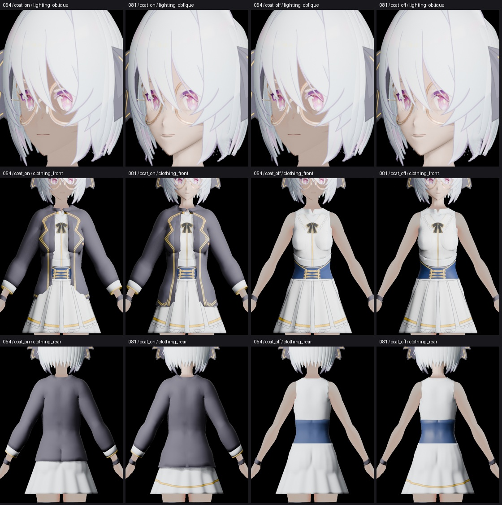
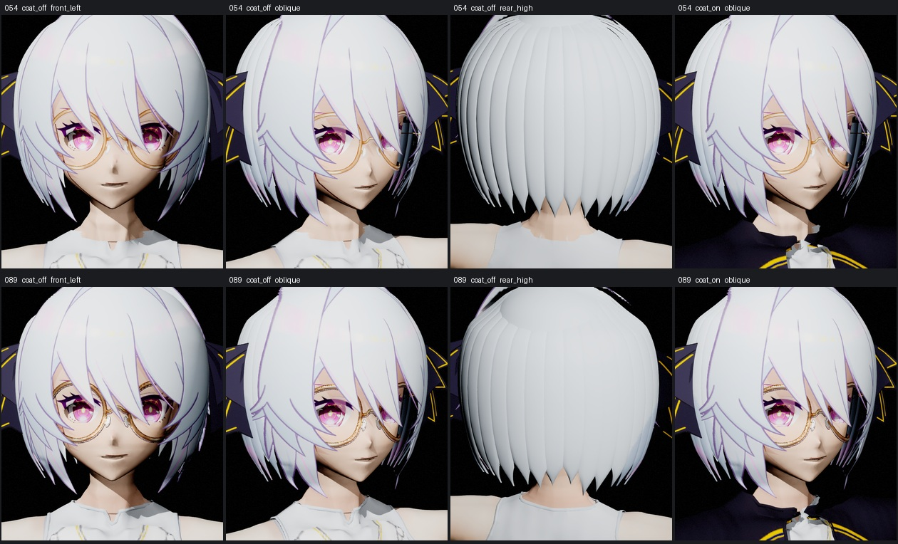
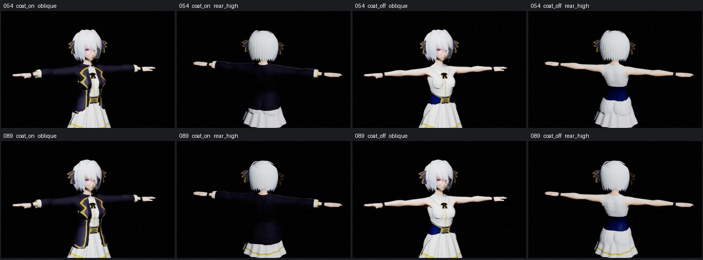

# 白绮 054 与 081 累计对照

两版都用各自的完整 Blender 工程，给两种形态摆同一姿态和机位，复用同一组灯光。对照着看，054 在斜侧光下脸颊和鼻梁主要靠颜色分块，081 的脸颊能随光位读出体积，颈根与领口也更连贯。081 在强光下仍能看到虹膜和镜框的亮点。脸型、原嘴部、CC0 身体及骨架在这一轮持续锁定。

穿外套版由较短的衣摆变为更清楚的独立外套下摆，正面翻领、两侧收边和裙摆分层更明显。无外套版的上衣、腰封和裙片交界更清楚。两种形态的后裙都有原金边的延续。背面肩臂轮廓仍取决于原 CC0 体型和动作，衣服只是覆盖其外部。

081 各形态的 33 组动作和 197 个采样、原 CC0 记录及引擎读回随版本保留。对比图来自离线场景。游戏安装使用此前正式版本，后续正式发行再用实机核对场景灯光、换装预览和传承形态。 [081 工程和测量存档](https://github.com/XenoAmess/PBZ_vivhite_mod/releases/tag/baiqi-model-081)

## 054 与 089 的 Unreal 离线对照

将 054 正式包的两份 FBX 和烘焙 PNG 读入 UE 5.7.4，用预览材质读取各版本贴图。复用 089 的机位、灯光、曝光和打包用分区投影设置。各版分别出两种形态、两档距离和四个机位，共 32 张中立姿态对照。正式发行还需要用实际游戏材质、场景和动作核对。

054 脱外套版的前颈和上衣开口之间露出几个明显的折线色块，后颈也能看到断开的衣领轮廓。089 在相同角度有连续的颈根受光和细包边，正面下颌的双重暗线也减弱了。原嘴部和头脸网格仍按原版检查。两种形态的后裙都能看到金边，穿外套的正面下摆更清楚。

089 近景仍能看到鼻底小块暗影，以及在金圈亮边旁断续的深色线。金圈的黑边和印在刘海上的线条在近景会争抢眼部细节。头顶从斜后看仍有暗带，既有分件试验已将它定位到前发背面。半身预览主要读到整体发型和两种衣服的层次。后续用斜视和左右侧光单独复核可见的深色镜框边，头顶继续用分件图核对背面受光。 [头顶分件记录](baiqi_crown_joint_probe_081.md)

