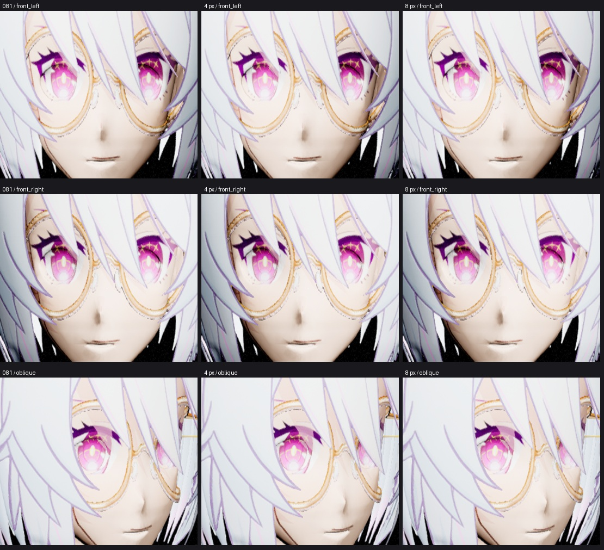

# 白绮 082 镜框边缘

081 的 Unreal 近景里，细金边局部出现断续的深色毛边。原生材质读取 RGB 色图，图中金边轮廓外仍有透明区域留下的深色像素。即使网格已经沿轮廓裁切，纹理过滤依然会混入这些颜色。

对比沿轮廓向外补 4 和 8 个纹素，采用 4 个纹素。优先从最近的高覆盖金边像素复制颜色，并保留原图达到裁切阈值的 15,927 个纹素。补色共影响外围 7,095 个纹素。两种形态的 Blender 工程逐字节等同于 081，原嘴部、眼部贴图、CC0 身体和骨架保持原样。99 张原生图中只有镜框色图的哈希改变。

固定 Unreal 近景中，4 个纹素的影响集中在金边。脱外套的三张可见角度上，单通道差超过 4 的像素分别是 1,106、1,188、841。用这些差异区域估算亮度低于 110 的显示像素，从 65、64、16 降到 62、59、15，局部边缘稍连贯。8 个纹素带来更宽的变化范围，保留 4 个纹素的处理。双形态各看五种眼部状态与四个机位，10 张斜后视图逐像素一致。

两种形态各复验 33 组动作、197 个姿态，采样指标与 081 一致，各保留 20 项原 CC0 记录与 0 项新增标记。UE 5.7.4 读回两套 348 骨资源以及四种眼部切换。当前存档是离线候选。

复现时，在原生贴图烘好后运行 `py -3 scripts/bake_baiqi_frame_padding.py --inputs build/baiqi_082_game_inputs --radius 4`。存档附双形态 Blender 工程、烘焙输入、UE 读回及动作报告。

