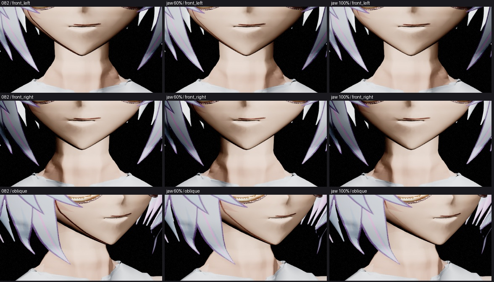

# 白绮 083 下颌轮廓

083 处理了斜视图下颌上的第二条深色线。Live2D 的 `ArtMesh116` 描线适用于二维外轮廓，投影到有深度的头部后，描线与三维下颌边缘在斜视时分开。光线转换后，较深的线依旧贴在相同的面部位置。

对照保留描线、下颌段减弱 60% 与下颌段减弱 100% 三档。采用 100%，在轮廓进入下颌的 16 纹素内渐变。斜视图主要剩下几何轮廓和受光过渡，嘴部像素、眼妆和面颊的基准肤色保留。每张眼部状态图的改动为 1,085 个原始像素，只在原描线的删除区域。99 张原生图中只改了五张脸部色图。双形态 FBX 全部三角面的坐标和 UV 逐面一致，CC0 身体、骨架、原头型保持原样。

Unreal 5.7.4 同机位对照覆盖两种形态、五种眼部状态和四个角度。中性脱外套斜视图有 1,923 个像素的单通道差大于 5。10 张斜后图逐像素一致。两种形态各 33 组动作、197 个姿态的结果与 082 一致，各保留 20 项原 CC0 记录与 0 项新增标记。UE 回读两套 348 骨网格和四种眼部状态切换。当前存档是离线候选。

此次 Unreal 对照在编译会话遮罩与法线后出图，修复了旧离线材质预览的黑色线性纹理采样。用同一配置重新出图 082 和 083，再作比较。 [预览复现方法](../../repro/baiqi_unreal_offline_preview.md)

复现时先用含 GLFW、PyOpenGL 的项目 Python 运行 `scripts/bake_baiqi_jaw_outline.py --poses <078 poses> --out <083 poses> --amount 1`，再用 `scripts/apply_baiqi_eye_glints.py --jaw-outline` 写入两套 Blender 工程。存档附双工程、烘焙输入、状态原图和动作报告。

