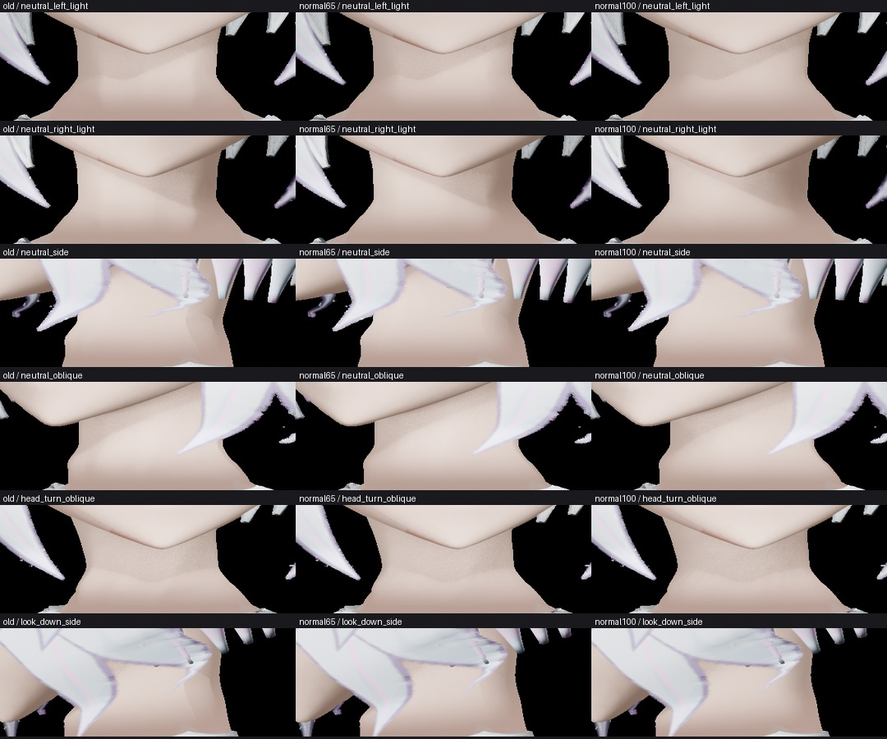
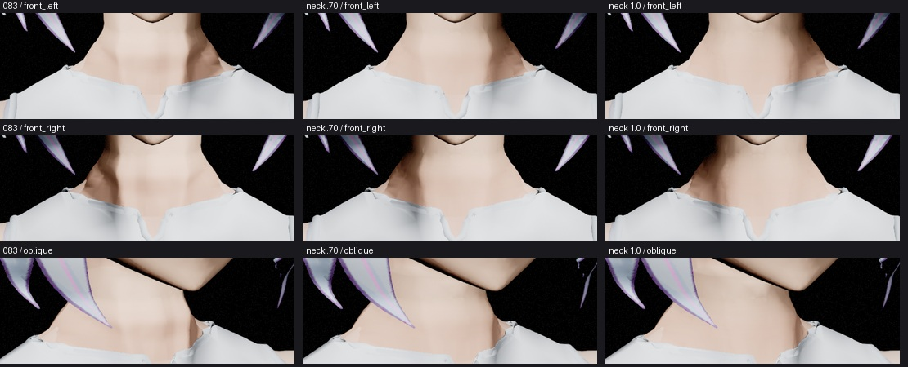

# 白绮 084 补颈受光

侧视和低头时，白绮补颈靠后侧出现一条折线。对照原 CC0 颈面，折线集中在白绮接头用的补颈上。沿原颈面的方向取样，在两表面接近处渐进地校正补颈的受光方向。Blender 两种形态均修改补颈的角点法线，头脸网格和 CC0 身体保持原样。未参与补颈的头部角点法线无可测偏转，CC0 原角点法线逐个一致。

单纯把自定义法线写进 FBX 后，Unreal 读回的 40 张图与 083 逐像素一致。最终做法在 Blender 工程保留可编辑的补颈法线，并把同一方向差烘成 512 × 512 的切线空间贴图。导出 FBX 保留 083 的网格法线，贴图只绑定到白绮补颈材质。99 张原生图的哈希一致，新增一张补颈法线图，原肤色、眼部和嘴部贴图保持原样。

Unreal 同机位对比强度 0.70 与 1.0，采用 0.70。正面颈部压暗的横带减弱，斜面仍能辨认侧颈转折。双形态正面左右灯的四张图中，横带固定取样区的亮度范围由 13.1–13.5 降至 6.9–7.4。Blender 侧视与低头图的补颈硬折减弱，轮廓位置保持原样。两种形态各复测 33 组动作、197 个姿态，指标与 083 一致，原 CC0 的 20 项记录保留、新增标记为 0。UE 5.7.4 读回补颈法线图及强度、双形态 348 骨资源与四种眼部状态。当前存档是离线候选。

复现先用 `scripts/match_baiqi_neck_normals.py` 处理 083 的工程，输出双形态工程与 `T_BaiQiNative_NeckBridge.png`。导出两形态后，把这张图通过 `scripts/bake_baiqi_native_material_inputs.py --surface-finish --neck-normal <PNG>` 接入补颈材质，其余材质与状态流程继续沿用 083。

