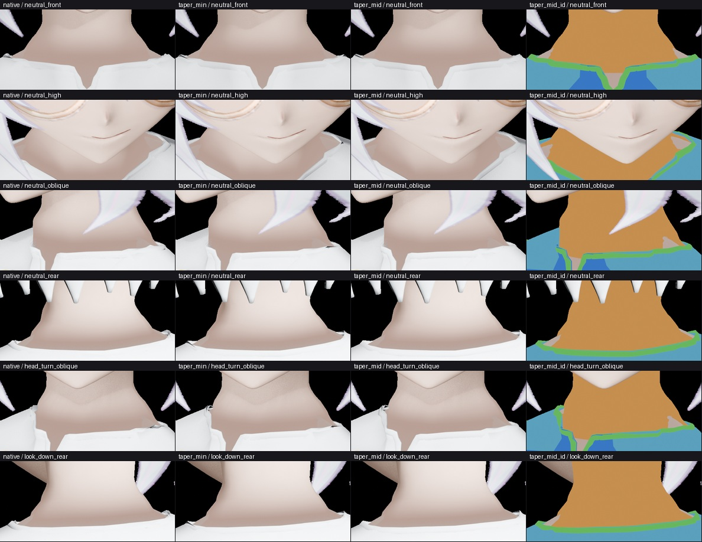
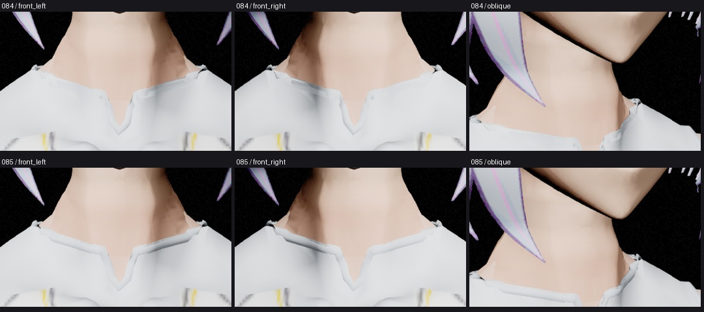

# 白绮 085 领口包边

084 的白色领口有几处短断线。纯色分层和单独隐藏上衣后看到，包边的一部分沉进上衣表面。初次整体重贴包边会在两肩附近留下细缝，最终用原领口边界作固定线，从内侧逐渐贴合更新后的上衣表面。

保留贴颈一侧的 40 个边界顶点，调整其余四列的 160 个包边顶点，最大位移 2.40 毫米。两种形态共用这项改动，袖口包边保留。脱外套正面拆层图中，所取区域最大连续包边由 1,773 像素增至 7,811，后视由 2,011 增至 7,298。转头和低头的取样亦有改善。Unreal 中性正面与斜面可看到更连贯的白边。

两套 FBX 各有 320 个包边三角面的位置改变，1,008 个包边三角面的 UV 一致，其余区段坐标与 UV 一致。100 张原生图逐张一致。CC0 身体、骨架、白绮脸和补颈、上衣保持原样。

两种形态各复验 33 组动作、197 个姿态。包边与补颈的三角面交叉累计由 2,543 降至 1,101，单姿态最高由 86 降至 82。包边与原身体皮肤的交叉累计由 17,586 降至 17,571，其它接触及变形指标一致。各保留 20 项 CC0 记录并无新增标记。UE 5.7.4 读回双形态 348 骨模型和四种眼部状态，离线出图共 40 张。当前存档是离线候选。

用 `scripts/refit_baiqi_neckline_binding.py` 处理 084 的两套工程，再沿用 084 的导出和烘焙参数。存档附两套 Blender 工程、烘焙输入、动作报告和分层对照。

