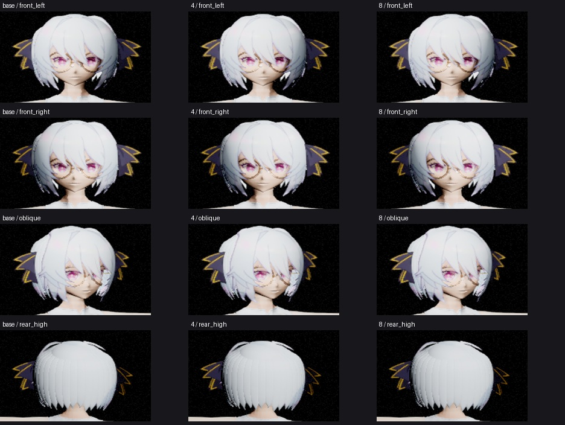

# 白绮 086 前发边缘取样

前发以裁切网格呈现发梢形状。原生 RGB 图在裁切边缘外有深色像素，缩小取样时会把这些颜色混入白发。沿用 082 镜框的补色办法，由邻近高覆盖像素向外补色，前发分别对照 4 和 8 个纹素。

采用 8 个纹素，处理轮廓外 34,868 个纹素。在裁切阈值上及以上的 240,440 个颜色纹素逐个一致。用方框缩小模拟检查边缘颜色，比较只由裁切内颜色贡献的参考值。四倍缩小时，部分覆盖块的平均通道误差由 26.12 降至 1.88。八倍缩小时，原图、4 纹素和 8 纹素档的误差分别为 41.81、17.92、7.82。这项测量是贴图缩小对照，Unreal 远机位另有同场景截图。

实际 Unreal 近景中，4 和 8 两档差异较小。375 厘米机位下，脱外套正面两个灯位和斜视相对 085 分别有 491、548、440 个像素的单通道差大于 4，变化集中在头部。最终对照覆盖两形态、40 张近景和 8 张远机位图。

两套 Blender 工程逐字节等同于 085。100 张原生图中只改前发色图。两种形态各复验 33 组动作、197 个姿态，结果与 085 一致，各保留 20 项原 CC0 记录与 0 项新增标记。UE 5.7.4 读回两套 348 骨网格和四种表情切换。当前存档是离线候选。

复现时在 085 的原生贴图流程后增加 `scripts/bake_baiqi_frame_padding.py --inputs <导出目录> --target fringe --radius 8`。远机位使用离线预览的 `portrait` 档。存档附完整工程、烘焙输入及动作与图像对照。

