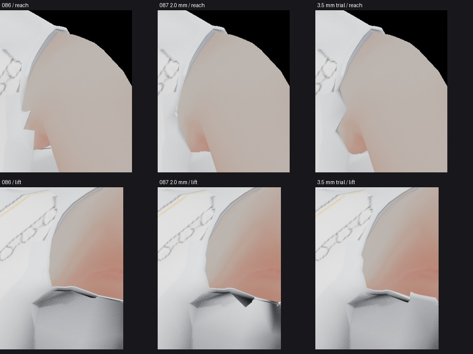
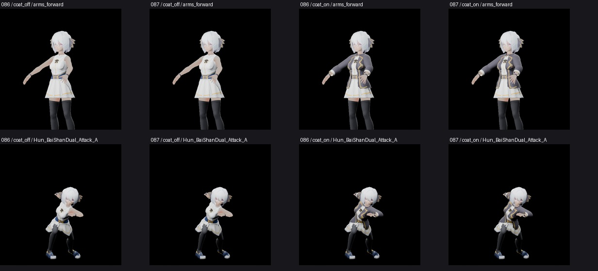

# 白绮 087 上衣袖窿

伸臂时上衣袖窿出现两段尖角。材质拆层中，异常沿着上衣与原肩臂皮肤交界分布，原 CC0 肩臂在相同姿态下保持自己的轮廓。以八个常见静止和抬臂姿态测量局部接触，只在袖窿和邻接衣料渐进增加余量。3.5 毫米档会在抬臂时顶起布边，采用 2.0 毫米档。双形态共用这一套上衣。

上衣移动 61 个顶点，包边同步移动 195 个顶点。固定八姿态的近皮肤样本由 93 个降至 75 个。局部近景中，前伸时原来的两段尖角更平顺。FBX 读回的坐标变化只在上衣正面、背面和包边三个材质区段，原始多边形索引及各角点的 UV 一致。100 张原生贴图的哈希一致。白绮头脸、CC0 身体和骨架通过原有哈希检查。

两种形态各复验 33 组动作、197 个姿态。上衣与皮肤的交叉累计从 44,070 降至 42,503，包边从 17,571 降至 16,072。穿外套时，外套和内层上衣的累计交叉由 103,767 降至 97,734。其余姿态变形和接触数据一致，各保留原 CC0 的 20 项记录，新增标记为 0。前伸、外展和双刀攻击另有同机位渲染。UE 5.7.4 读回两套 348 骨网格和四种眼部状态，按打包分区投影配置出图 40 张。当前存档是离线候选。

用 `scripts/fit_baiqi_armhole_clearance.py` 在 086 工程上复现，再沿用 086 的贴图参数。存档附两套完整工程、烘焙输入、动作报告和 FBX 读回。

