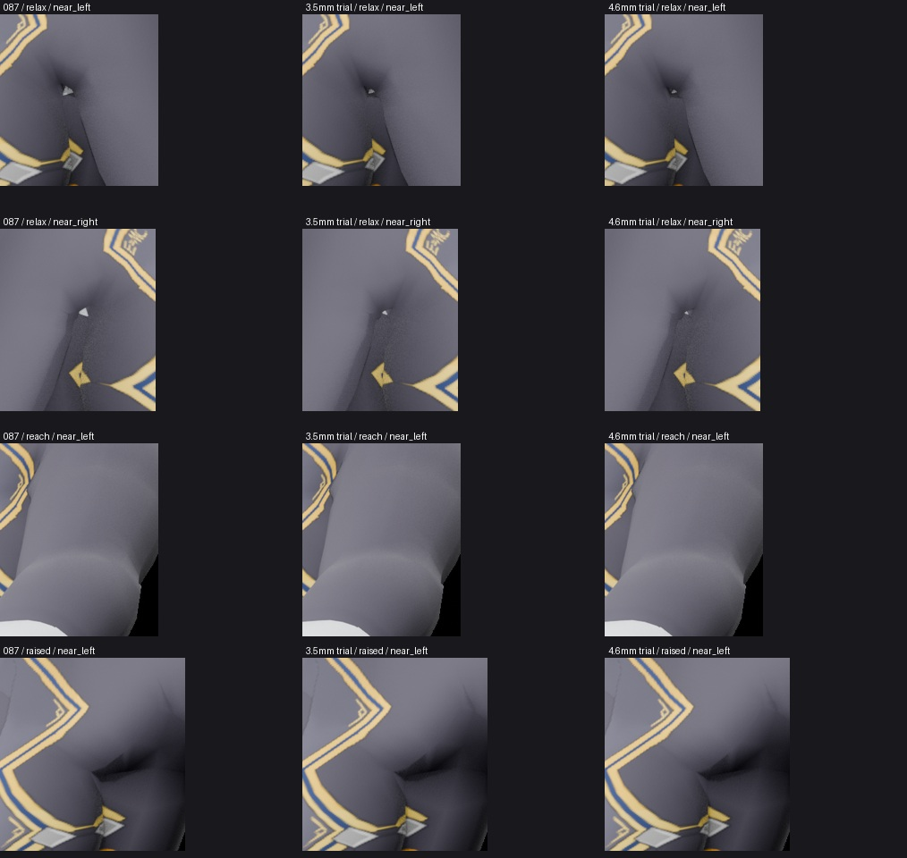

# 白绮 088 外套腋下余量

外套腋下的浅色尖点在统一灰模中仍可见。相机射线命中无袖上衣，确认浅色来自内层衣料穿出。比较向前、向外和组合偏移后，用逐渐衰减的位移整理腋下褶皱的内侧。两侧合计调整 32 个外套顶点，最大位移 4.6 毫米。放松姿态的左右固定测区中，命中内层上衣的射线由 62、50 降至 11、6，近景仍可看到小范围残留。另比较前伸、侧举和抬臂，局部处理保留原袖形和金边图案。

变动仅在穿外套工程。FBX 的原始多边形索引及各角点 UV 与 087 一致。外套正面和背面材质区段分别有 612、340 个角点的坐标改变。脱外套 Blender 工程逐字节等同 087。100 张原生纹理哈希一致，CC0 身体、原头脸、骨架及内层上衣通过原工程哈希检查。

两种形态各复验 33 组动作、197 个姿态。穿外套时外壳与内层上衣的累计交叉从 97,734 降至 92,310，外壳与皮肤从 44,777 降至 44,688。其余接触及变形数据一致，各保留原 CC0 的 20 项记录和 0 项新增标记。UE 5.7.4 读回两个 348 骨网格与四种眼部切换，分区投影下两套共 40 张近景，另比较远机位。脱外套的 20 张近景和 087 逐像素一致。当前存档是离线候选。

用 `scripts/fit_baiqi_coat_underarms.py` 处理 087 工程，再沿用该版的导出和贴图参数。存档附双工程、烘焙输入、动作报告、FBX 读回及相机射线试验记录。

