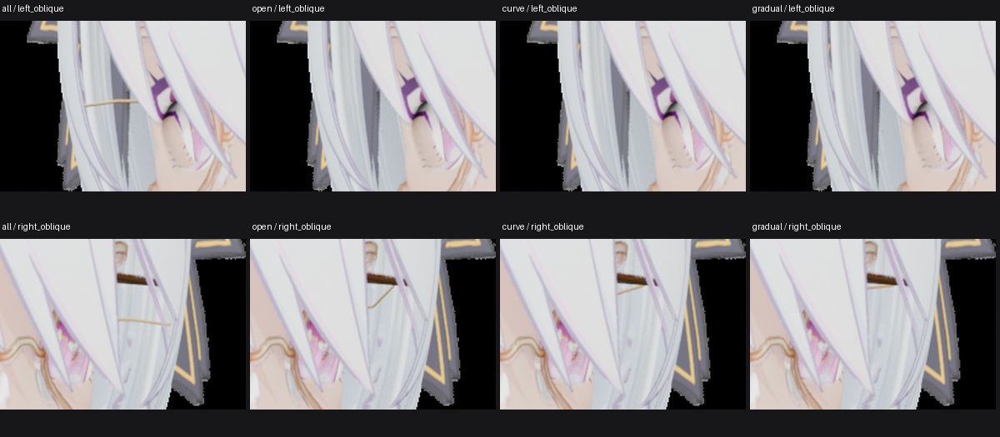
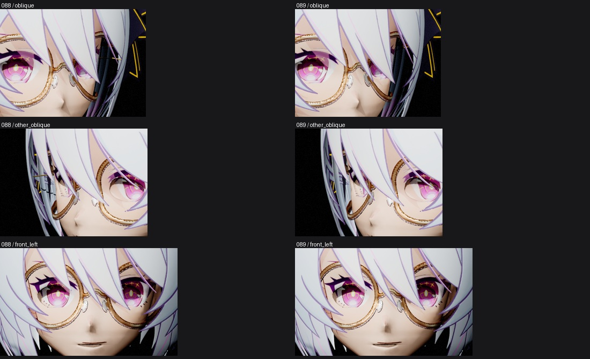

# 白绮 089 镜腿连接

旧版斜视可见一段横在白发前的金线。单独显示镜腿可复现。用导出时同样的透明轮廓裁切和厚度生成镜框，量到两根镜腿前端中心与实际镜框的最近距离分别为 19.14 和 24.04 毫米。逐步修整镜腿弯度，在保留尾段的情况下让两根镜腿前端落到各自的镜框上。

两种形态各移动 48 个镜腿顶点。前端中心距离小于 0.01 毫米，与裁切镜框产生接触。Unreal 左右斜视中，原先悬空的横线消失。FBX 坐标变化只在两个镜腿材质区段，各 80 个角点，原始多边形索引及 UV 逐项一致。100 张原生纹理逐张一致。原头脸、圆镜框、CC0 身体和骨架通过原有哈希检查。

动作套组增加 `--temple-contacts`。两种形态各 33 组动作、197 个姿态中，两根镜腿与头部的交叉数始终为 0。其他变形和接触数据与 088 一致，各保留原 CC0 的 20 项记录，新增标记为 0。另抽看转头、抬低头与双刀攻击近景。UE 5.7.4 读回两个 348 骨网格与现有四种眼部切换，分区投影下出图 40 张，另做左右斜面对照。当前存档是离线候选。

用 `scripts/fit_baiqi_glasses_temples.py` 处理 088 的两套工程，再沿用该版的导出与贴图流程。存档附双工程、烘焙输入、动作报告和 FBX 读回。

