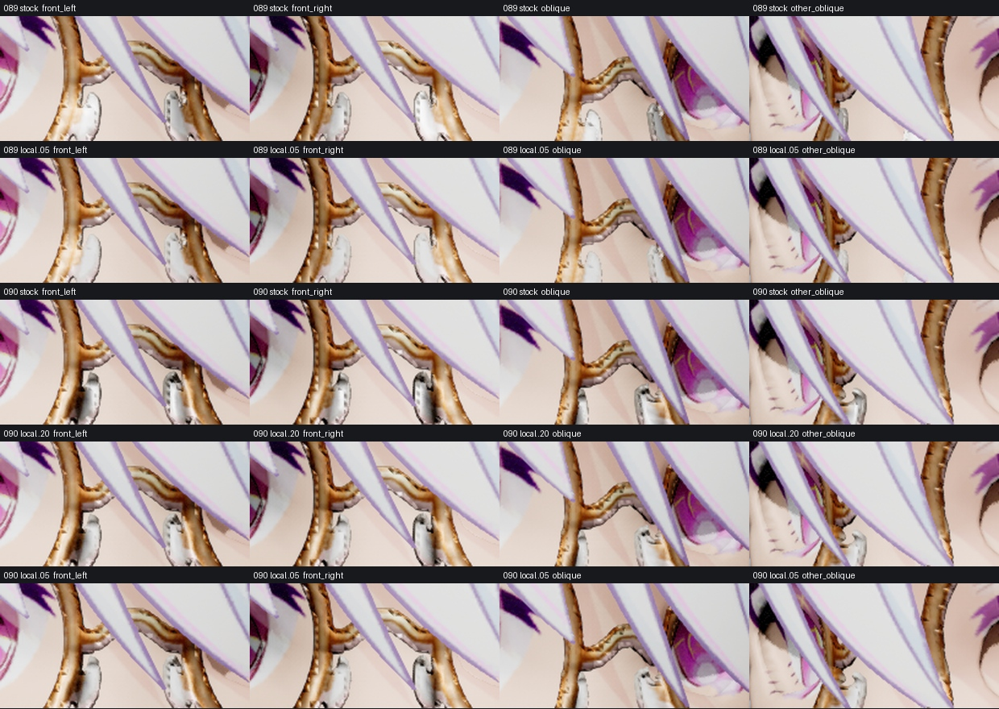

# 白绮 090 镜框鼻托材质

原鼻托和金圈共用金属度 0.62 和粗糙度 0.46。用游戏导出所用的裁切轮廓量出两枚鼻托约 8.3 毫米的间隙。贴近试验把中位间隙降到约 1.7 毫米，未增加镜框与脸部的三角面交叉，但正视近景在两枚鼻托上出现更大的黑斑。090 保留 089 的几何位置。

从原眼镜色图的鼻托范围提取近中性色遮罩，给两枚鼻托混入粗糙度 0.67、金属度 0.05。遮罩在 1024 像素贴图上有 1,200 个纹素的有效范围，独立于已有的圆框曲率法线。PNG 中只有 `T_BaiQiMix_0bafcbdc8af4d8.png` 的内容发生变化。双形态 FBX 的位置、多边形顺序、区段索引和 UV 逐项相同。Blender 工程把同一份数据图用于镜框预览。

Unreal 两个正视灯位与左右斜视均复看过。在鼻托差异区域内，显示亮度低于 100 的像素依次由 91、57、88、25 降到 39、44、48、16。显示亮度超过 232 的像素由 277、299、65、52 降到 2、7、0、0。对比图单独列出改变几何的试验。现有鼻托的间隙仍可在极近的斜视中看见。

两种形态各跑 33 组动作、197 个姿态。数据与 089 一致，各有 20 项 CC0 记录，新增标记为 0。另抽看转头、仰头和双刀攻击的彩色及灰模近景。UE 5.7.4 读回双形态的 348 根骨骼与四种眼部切换，按打包分区投影出图 50 张。当前存档用于离线评估。

复现用 `scripts/bake_baiqi_frame_pad_materials.py` 读取 089 的输入，再用 `scripts/apply_baiqi_frame_roughness.py --pad-finish` 写入两套 Blender 工程。沿用 089 的导出与烘焙流程，并在 `scripts/bake_baiqi_native_material_inputs.py` 加 `--frame-pad-finish`。

