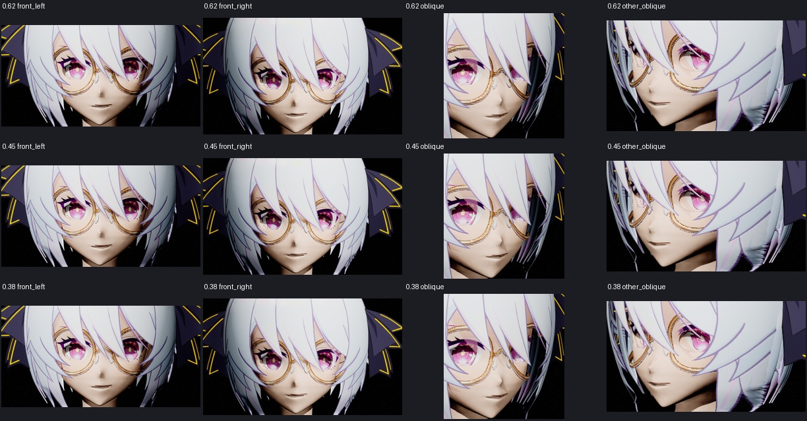

# 白绮 091 金色镜框受光

090 的同机位近景里，金圈的亮线旁有断续深边。关闭圆框法线和降低金属度分别做了对照。保留 090 的鼻托参数、金色底图、粗糙度 0.46、镜面值 0.27 和圆框法线 0.65，对比金圈金属度 0.62、0.45、0.38。0.45 的深边较轻，侧光下仍能看出金色明暗，0.38 在半身图的金圈高光更淡。

两种形态共八张固定近景，以 0.62 与 0.38 的差异像素作为测区。0.45 使显示亮度低于 100 的像素合计由 40,842 降至 28,948，亮度高于 225 的像素由 1,412 降至 872。在八张半身同机位图的对应测区中，低于 100 的像素由 267 降至 158。两档距离的背视图逐像素一致。这些数值来自固定灯光与曝光的 UE 离线预览。

相比 090，100 张原生图仅 `T_BaiQiMix_0bafcbdc8af4d8.png` 的金属度通道改变。粗糙度、AO 和鼻托完全覆盖区数值逐像素一致。双形态 FBX 位置、拓扑、UV 和区段相同，原脸、嘴部与 CC0 几何经哈希复核。两种形态各通过 33 组动作、197 个姿态的数值复查，各保留 20 项 CC0 记录与 0 项新增标记。UE 5.7.4 读回双形态的 348 骨网格和四个眼部切换，出 50 张近景。

复现使用 `scripts/bake_baiqi_frame_pad_materials.py --metallic .45`，将生成图写回 090 的两套工程。导出及原生烘焙沿用 090 参数，增加 `--frame-metallic .45`。

