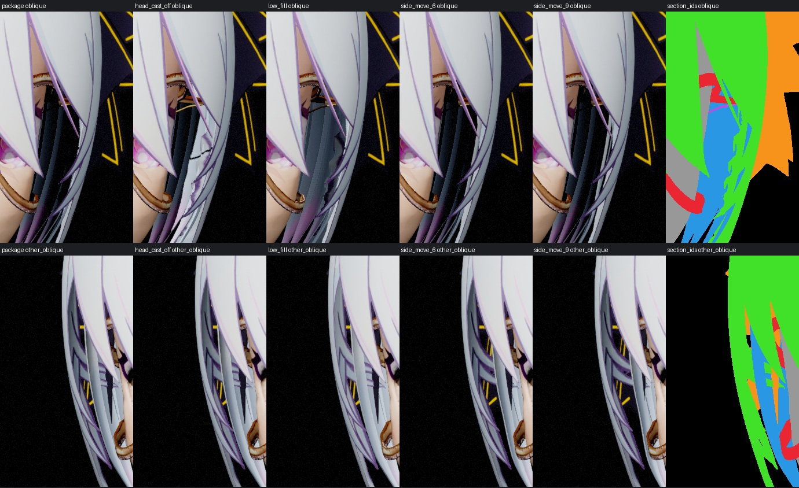

# 091 侧发暗带和投影对照

用同一套 Unreal 网格分别输出彩色图、分区色、底色和世界法线。固定斜视中遮住远侧镜框边的一条深带属于侧后发束。底色图中这里是浅蓝白色，Blender 分件上色能看到最前侧的几束后发与刘海在这个角度交叠。

脱外套的固定斜视中，在原侧发测区内，沿用打包分区投影时中位显示亮度是 19.27。单独关闭脸部网格区段投影升至 58.08，增加两盏低强度背侧填充光升至 68.53，关闭模型投影升至 201.09。对侧斜视的原中位亮度为 164.60。头部投影和入射光都影响暗带，保留模型本身的头部投影设置。

几何试验把最前两侧各两束后发的中下段逐步后收。6 毫米与 9 毫米的两种 UE 输出版，对原本最暗的一侧几乎没有改善。另一侧同一区域低于 80 的显示像素由 43 增为 1,928 与 2,857。Blender 剪影实验中各档正面轮廓一致，侧视变化很小。两套形态的网格继续使用 091。

