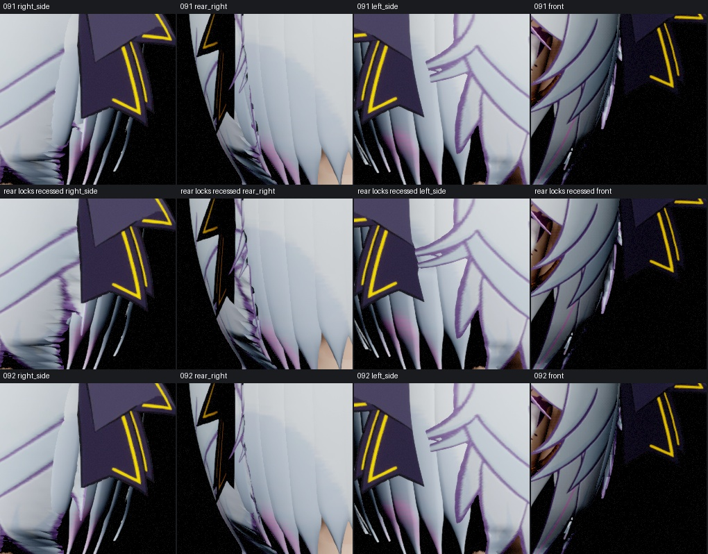

# 白绮 092 耳侧前发深度

发饰下的前发边缘在侧视和斜后视里带有细碎的褶线。单独隐藏后发后仍能看见这一处，关掉刘海法线贴图也保留了主要褶线。原贴图对应的边线较平滑。原网格在相邻约 3.15 毫米的横向距离上，深度最多跳变 20.57 毫米。

从 14 排前发深度拟合连续剖面，只校正发饰下这段前发的前后坐标。每套 259 个顶点有变动，最大 6 毫米。固定测区相邻顶点的深度差第 95 百分位由 14.78 降到 12.22 毫米，最大差由 20.57 降到 18.43 毫米。前视的网格投影坐标与 UV 保留，侧视接边更平顺。斜后近景仍可见少量原有细线。

另外试验了将四束后发内收，裁切网格的交叉对数由 552 降到 105。该方案露出了更多原前发的起伏边。只修前发的一档在两侧和斜后对照中较稳妥，故选为 092。

复现用 `scripts/smooth_baiqi_fringe_side_depth.py` 处理 091 的两套 Blender 工程，沿用 091 导出和全部原生烘焙参数。双形态 FBX 位置变化仅在前发区段，各 2,360 个角点。多边形顺序、区段索引和 UV 逐项相同，100 张原生纹理逐张一致。原头脸、原嘴部、CC0 身体和骨架经既有哈希复核。

两种形态各跑 33 组动作、197 个姿态。前发与脸、圆镜框的相交计数始终为 0。在 Blender 带厚度的动作预览中，前发与后发的相交范围由每姿态 3,884–3,886 对降到 3,614–3,618 对。其余动作数值和接触数据与 091 一致，各有 20 项原 CC0 记录和 0 项新增标记。另抽看转头、仰头和双刀攻击近景。UE 5.7.4 读回两套 348 骨网格、四种眼部切换，输出 50 张常规近景和 12 张接边机位图。当前存档用于离线验收。

