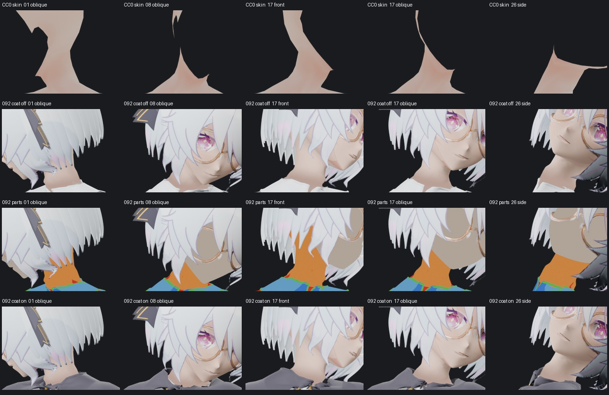

# 092 颈肩专项复查

两种形态分别用同一个 Blender 动作套组复看屈伸、转头、侧倾、头部枢轴、组合颈姿、双臂前伸、耸肩和双刀攻击。每种形态检查 72 个姿态，并在正面、侧面、斜面和背面抽取 192 张灰模与贴图图像。

领口接触数据把问题集中到大幅转头叠加侧倾时。取 37 姿态组合用例的第 1、8、17、26 号采样，另取原生双刀攻击 25% 进度复看。号码从 0 起。第 17 号的转头角为 60°、侧倾为 25°，是领口包边与补颈的接触峰值，计 82 对三角面。

把领口包边、上衣、补颈与原身体涂成不同颜色后，可见包边沿领口主体延续，局部接触留在内缘。两套贴图图中未见明显断口。隐藏 CC0 原附带衣物观察皮肤时，部分侧颈边界带有折角，记录为原身体对照中的现象。当前继续锁定原身体和骨架，领口造型保留 092。

原生色图中，上臂基准 UV 的 RGB 为 244、203、181。脸部基准肤色的两个取样点和补颈上端各为同一 RGB。原有的面颊和颈根画稿保留各自的明暗。

