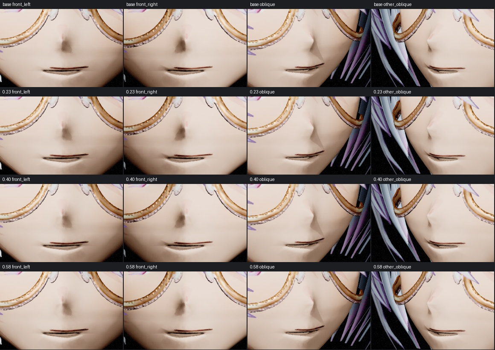
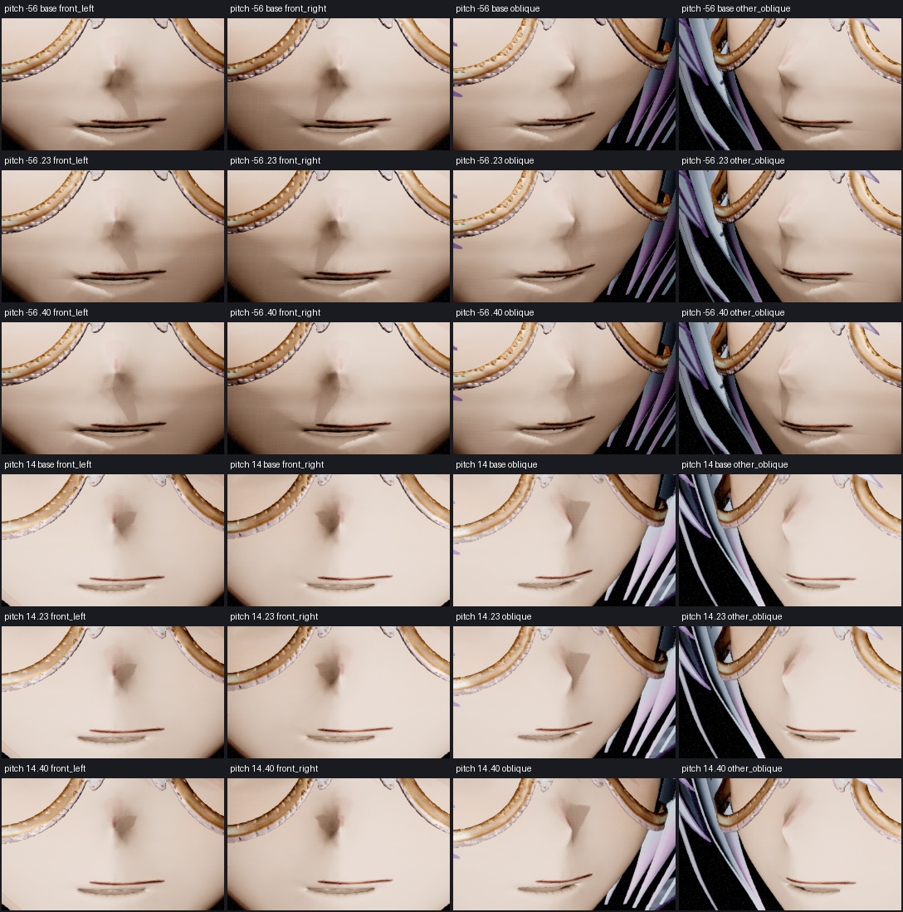

# 白绮 093 鼻尖下方受光

固定机位关闭模型投影，鼻下深色区域仍在。底色分层只看到原有的淡粉鼻纹。从原头模的 UV 三角面读取方向，在原色图约 x=429、y=506 处，表面法线的竖直分量为 -0.61。把这段向下的法线按原网格切线方向渐进校正，鼻梁和鼻尖的几何位置保持原样。

比较法线向上校正的三档，采用 0.40 档。原生贴图法线最大局部偏转约 17.8°，材质法线强度仍为 0.75。脱外套版常规两张正视灯位中，固定鼻部差异区域里显示亮度低于 100 的像素由 39、193 降至 20、60。较高顶光的两张正视图由 118、220 降至 17、50。低位主光四张图中，测区中位亮度增加约 5 级，鼻梁转折仍可见。另测面颊粗糙度，两档都只有少量显示像素达到差异阈值。

100 张原生图只改变五张脸部法线，每张改 520 个纹素，落在原生 1024 像素贴图的 x=487–510、y=636–668。原嘴、眼部图案、脸与手臂的基础肤色、补颈法线均通过逐张哈希核对。两套 FBX 顶点位置、拓扑、区段和 UV 与 092 一致。

两种形态各复测 33 组动作、197 个姿态，全部数值和接触记录与 092 一致，各有 20 项原 CC0 记录与 0 项新增标记。另抽看转头、仰头和双刀攻击的近景。UE 5.7.4 按打包分区投影出图 50 张，读回两套 348 骨网格及四种眼部切换。该存档用于离线验收。

复现先用 `scripts/rasterize_baiqi_nose_basis.py` 从 092 两套工程采样，然后用 `scripts/bake_baiqi_face_relief.py --nasal-strength .65 --nose-basis <NPZ> --nose-lift .40` 生成 Blender 与 Unreal 法线。`scripts/apply_baiqi_face_relief.py --replace-existing` 只更新 Blender 面部法线输入。面部原生法线完成后沿用五种眼部状态的烘焙流程。

