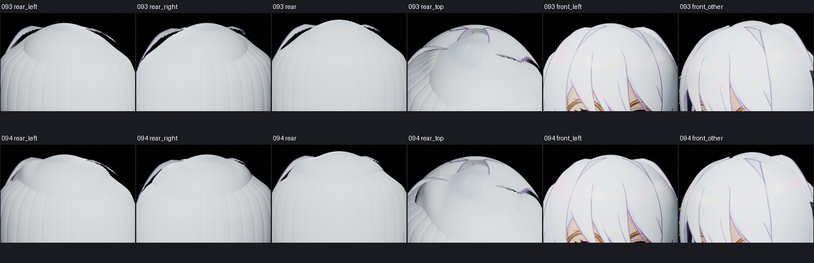
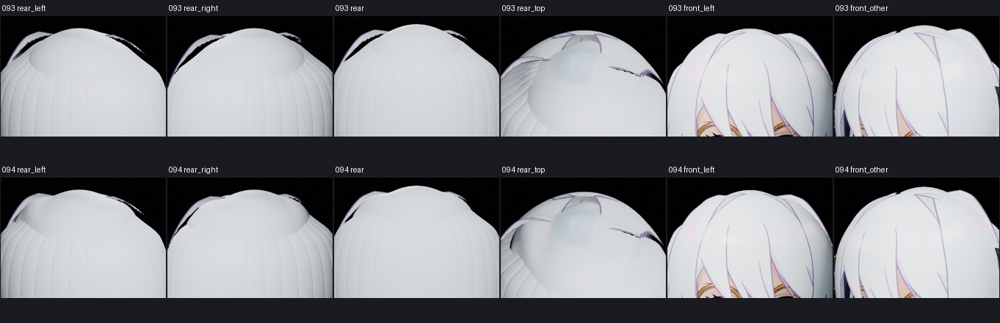
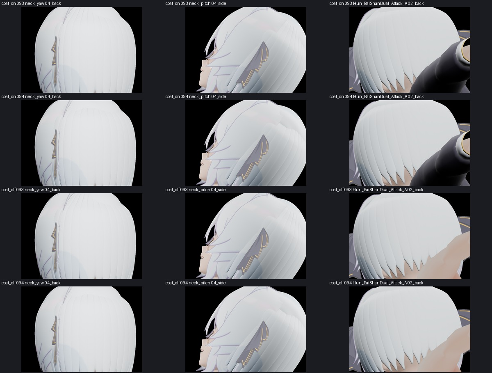
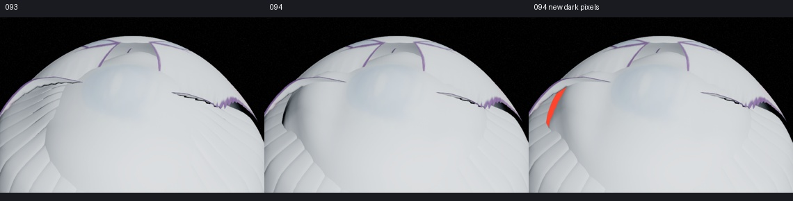

# 白绮 094 头顶前后发片衔接

后方机位看到的暗带来自前发背面和发底之间的落差。关闭头部和模型投影后，固定区域仍有 7,379 个亮度低于 80 的像素，原底色图层在同一区域的读数为零。沿正后方扫描裁掉透明区域的前发，在 3 毫米的横向切片上读取其上缘。前发相对整个后发最高点的落差最大约 22 毫米。只看发底网格时，最大落差约 46 毫米。

单独加入衬片能遮住暗带，在高角度却会显出新的接缝。只推前发深度会使一侧后斜视变暗。定向调前发法线能提亮部分像素，透出的窄缝仍在。094 用前发裁切后的上缘约束发底，仅沿原发底网格平滑抬升 438 个顶点，最大位移 28.7 毫米。发底上缘与前发的最大落差降至约 18 毫米。发片、面部、身体、骨骼和所有贴图均通过一致性核对。

UE 5.7.4 使用相同灯光、相同打包投影和六个机位重拍。在脱外套版头顶变化区，斜后左、斜后右、正后方中，亮度低于 80 的像素分别由 3,951、4,306、3,581 降至 188、251、143。更轻的抬升试验在这三个机位仍有较明显的暗带。当前档在极端后上方视角仍有一段较暗的左侧接缝，测区亮度低于 120 的像素由 575 增至 1,668，保留为下一轮检查项。

两种形态各跑 33 组动作、197 个姿态。原 CC0 记录各 20 项，新增数值标记各 0 项。发底与头部的接触计数逐姿态相同，与眼镜的接触全为零。原生发底与裁切后前发的静态接触由 67 对增至 170 对，两组发片在接合处叠合。未裁切源网格在动作报告中的发底／前发接触由每姿态 210 对增至 416 对。复核的转头、仰头和双刀出招近景中，变更集中在冠顶。两份 FBX 的 UV、拓扑和区段顺序完全相同，仅侧发材质段各有 1,744 个顶点角的位置变化。100 张原生图的 SHA-256 一致。Unreal 读回两套 348 骨网格及四种眼部切换。

复现使用 `scripts/fit_baiqi_crown_profile.py`，输入 093 工程及其烘焙清单。复测在原动作入口加 `--crown-contacts`。存档用于离线对照，实机待正式发行时检查。

同一模型也用于 6000D 联调。远端和模拟断连后回退到本机的默认批次各输出 72 张 1280×1280 图片，原动作和 CC0 记录的数值相同。另在 6000D 回测后视和侧视的转头、抬头及双刀攻击，共 72 张图。[远端执行和本机回退](../MAINTENANCE.md#6000d-统一服务调用)

