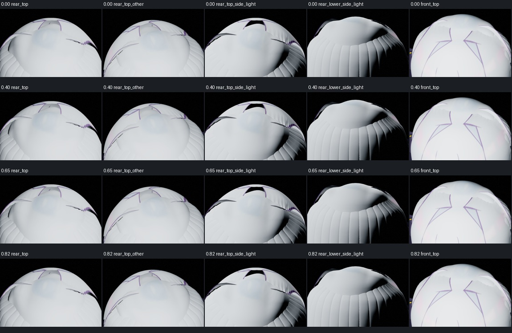
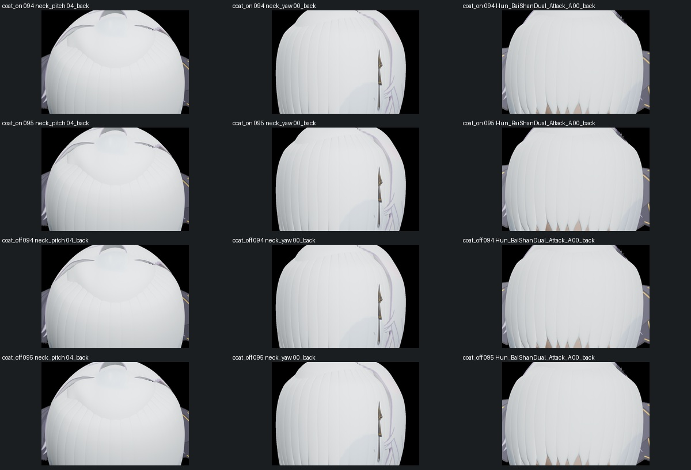

# 白绮 095 发底局部受光

094 在常用后视方向收窄了头顶暗带，极端后上方仍可见左侧暗线。先将抬升前的表面法线按位移范围混回发底，比较 0.48、0.74 两档。每档 FBX 的侧发区段有约 1,300 个顶点角的法线变化，两种形态各六张 Unreal 预览均与 094 逐像素一致。原有导入路径没有体现这项单独写入的法线变化。

将相同位置的方向差烘到发底单独的切线空间贴图后，引擎能够读到差异。同槽位的零强度对照与 094 逐像素一致。直接烘入原方向的试验加重了后上方暗线，最后使用反向切线偏移和 0.65 强度。UV 重叠时按后方深度保留可见的表面，投影 1,909 个纹素，441 个纹素的切线分量变化超过 0.003。Blender 由发底对象属性开启受光校正，原共用侧发材质可以在统一服务的固定脚本上照常识别。Unreal 导出时，仅分出发底区段绑定这张法线。[Blender 对象属性节点说明](https://docs.blender.org/manual/en/latest/render/shader_nodes/input/attribute.html)

十个固定机位与灯位组合比较零强度和 0.40、0.65、0.82。脱外套版中，后上方变化区亮度低于 120 的像素由 1,384 降至 650，换到偏侧光后由 5,474 降至 4,961，前上方机位由 350 降至 324。穿外套版趋势一致。0.82 在最明显机位还能减少约 80 个暗像素，采用较轻的 0.65 作为候选档。强侧光下仍可看到片与片之间的暗边。

两套原生 FBX 的顶点位置、UV 和拓扑逐项一致，发底各 1,088 面从侧发归入独立材质。既有 100 张原生图的哈希一致，新增发底底色、混合和法线图。完整烘焙后两套 348 骨网格及四种眼部切换通过读回，六个固定视图均与所选档的试验图逐像素一致。

本机动作回归每种形态 33 组、197 个姿态，与 094 的动作、接触和验收数值一致。每种形态有 20 项原 CC0 记录和 0 项新增标记。近景复查抽了转头、仰头和双刀出招。统一服务完成两种形态的后视与侧视，共回收 72 张图，动作报告数值与上一版同批次一致。

复现使用 `scripts/bake_baiqi_crown_relief.py`，以 093 为形体参考、094 为待烘工程，并传入 094 的烘焙清单。导出后在原生贴图烘焙传 `--crown-normal <T_BaiQiNative_CrownRelief.png>`。离线存档包含完整工程、烘焙输入与验收报告。

