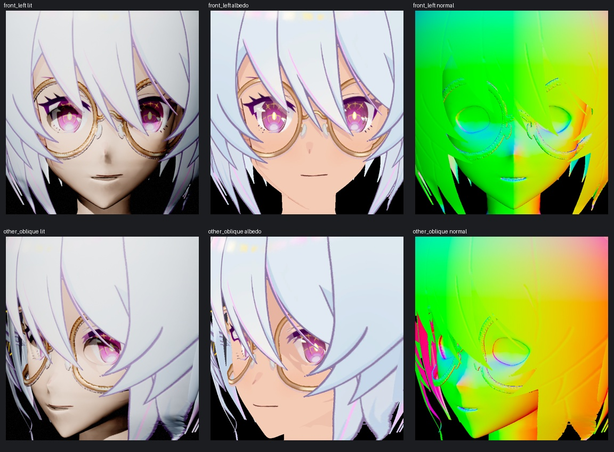
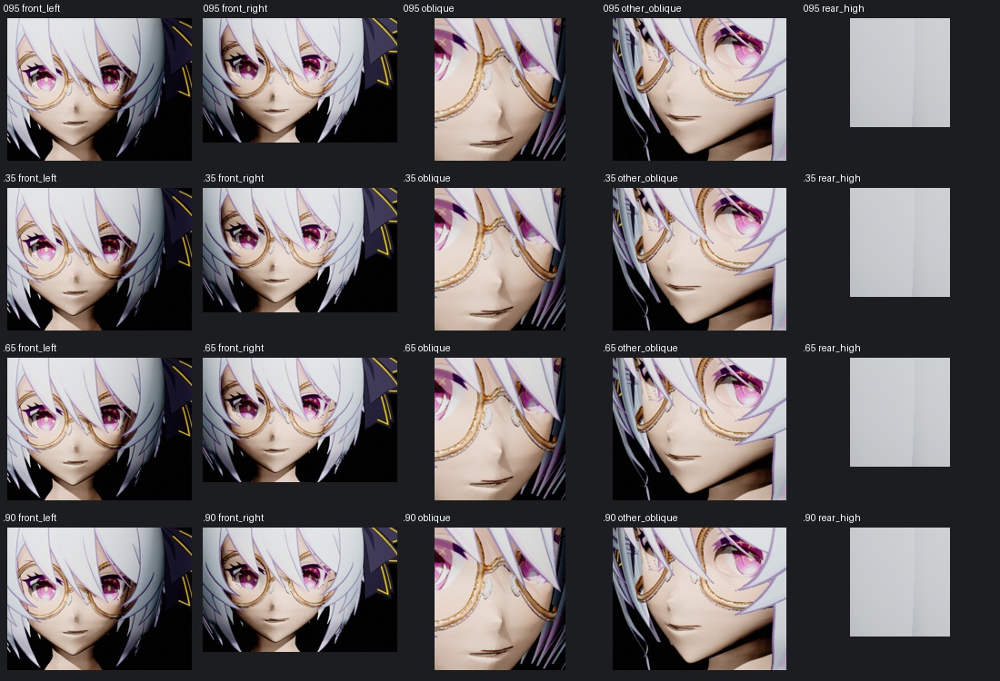
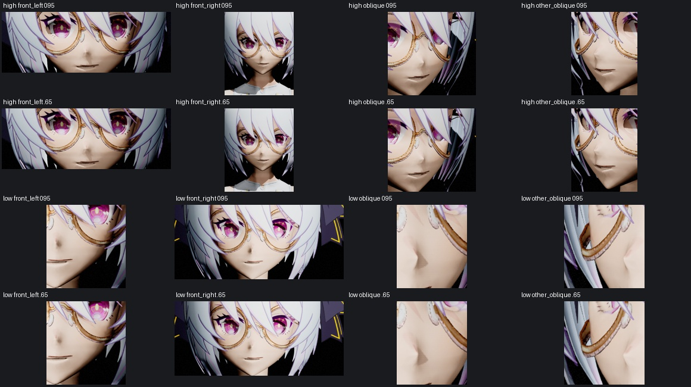

# 白绮 096 鼻尖中线受光

把 095 的脸部分成底色、法线和受光三种同机位图。鼻尖中线的底色本身只有一小段淡粉纹。源 UV 横截中，在约 x=429、y=491 和 y=501 处，相邻方向分别相差 29.4° 和 29.0°，深度连续。这个局部转折在正面换灯时会形成偏向一侧的深边。

在原有鼻底向上校正的基础上，单独比较 0.35、0.65、0.90 三档横向法线校正。采用 0.65。脱外套版正面右灯的固定测区中，亮度低于 100 的像素从 140 降至 45，高灯从 135 降至 41，低灯从 162 降至 35。相邻像素的法线显示梯度在同一正面测区第 95 百分位由 21.3 降至 12.4。斜视中仍可看到鼻梁和鼻翼的受光转折，正面左灯的较暗区域只略有变化。0.90 更强，采用保留侧面转折更清楚的 0.65 档。

103 张原生图中，五张脸部法线各改 1,482 个纹素，范围为 x=485–515、y=614–667。底色、原嘴图、眼部颜色和发底贴图均通过一致性核对。两种形态的 FBX 位置、UV、拓扑及区段完全一致。原 CC0 身体及头脸几何指纹保留。

两种形态各回归 33 组动作和 197 个姿态，数值与 095 相同，各有 20 项原 CC0 记录及 0 项新增标记。另查本机转头、仰头和双刀出招的面部近景，6000D 同批回收正视及斜视共 72 张图。UE 5.7.4 读回两套 348 骨网格及四种眼部切换，50 张离线图包含两种形态、五种眼部状态和五个视角。十张后视图逐像素一致。

复现时用 `scripts/rasterize_baiqi_nose_basis.py` 重建同时包含横向和竖直方向的 NPZ。烘焙使用 `scripts/bake_baiqi_face_relief.py --nasal-strength .65 --nose-basis <NPZ> --nose-lift .40 --nose-ridge .65`。Blender 使用 `scripts/apply_baiqi_face_relief.py --replace-existing`，原生烘焙随后沿用五眼部状态及 095 发底法线。

