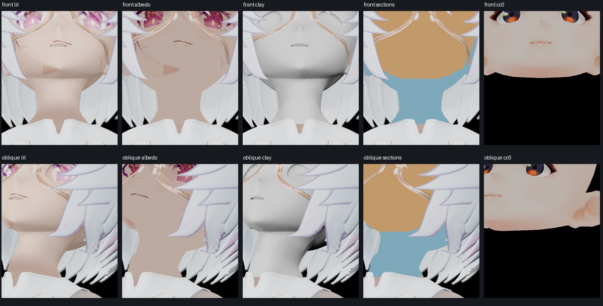
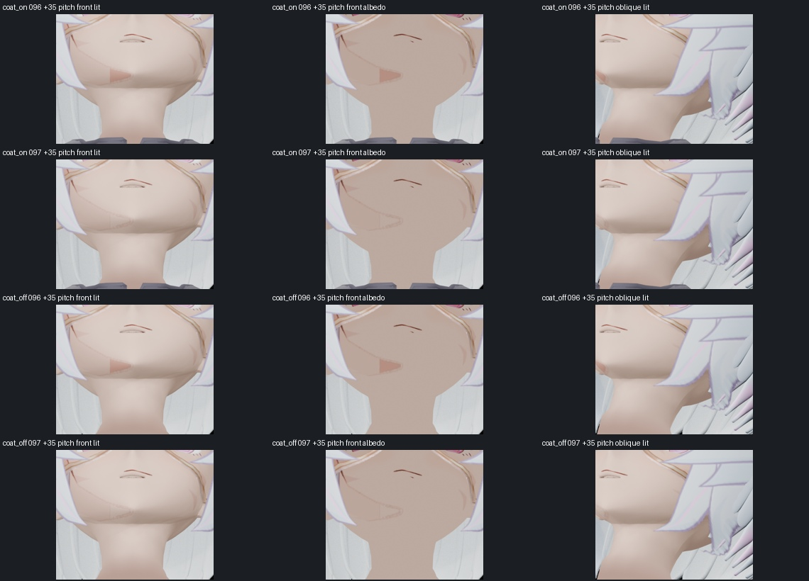
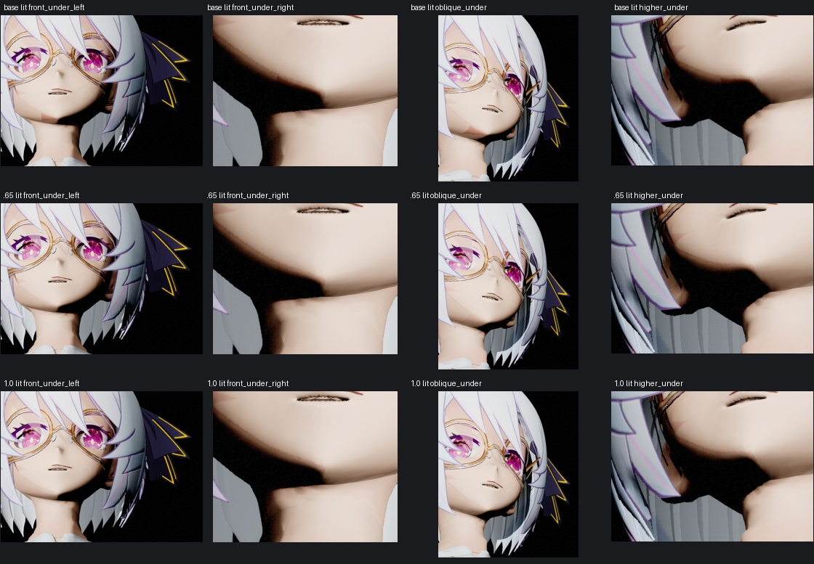

# 白绮 097 仰视下颌底色

在颈部屈伸用例的 +35° 仰头姿态，左侧下颌出现一块三角形色斑。底色图保留该色斑，统一灰模和同姿态的 CC0 原脸对照里看不到它。分件色图把它定位在白绮原创头部的面部材质。用相机射线把 1,623 个高红差屏幕像素对应到原图 UV，并逐层确认该色斑来自重叠的 `ArtMesh115` 与 `ArtMesh233`。这两层任意保留一层，中心仍为 RGB 230、188、178。

两层同时排除后，将局部露出的区域以原脸平涂色 RGB 254、243、234 补齐。比较 65% 和 100% 两档，采用 100%。五种表情的原图各改 723 个像素，区域在 x=387–440、y=578–619，原透明度和嘴部图像通过一致性核对。色样仍经由脸与上臂共用的肤色校准。

同灯光低角度的 Unreal 底色固定变化区，红绿通道差至少为 50 的像素在正面仰视中由 1,224 降至 61，在斜仰视由 1,805 降至 89。低位主光能看到大块色斑明显减弱，下颌仍有细淡的描线和正常受光转折。两种形态在 +35° 的 Blender 动作近景结论一致。

原生输入 103 张，五张脸部底色各改 1,501 个纹素，其余 98 张贴图的哈希一致。两份 FBX 的顶点位置、拓扑、UV、区段均相同。两种形态各做 33 组动作、197 个姿态，全部动作数值和接触记录与 096 一致，各有原 CC0 的 20 项记录及 0 项新增标记。UE 5.7.4 读回两套 348 骨网格和四种眼部切换，50 张常规预览及 24 张低角度图通过核对。6000D 回收两种形态共 16 张仰头动作图。

使用项目的 Cubism 光栅环境执行 `scripts/bake_baiqi_underjaw_tint.py --amount 1`，输入 083 核对后的五张源图。然后用 `scripts/apply_baiqi_eye_glints.py --underjaw-tint` 更新 096 双工程，并沿用 096 的鼻部法线和 095 发底烘焙。当前存档用于离线验收。

