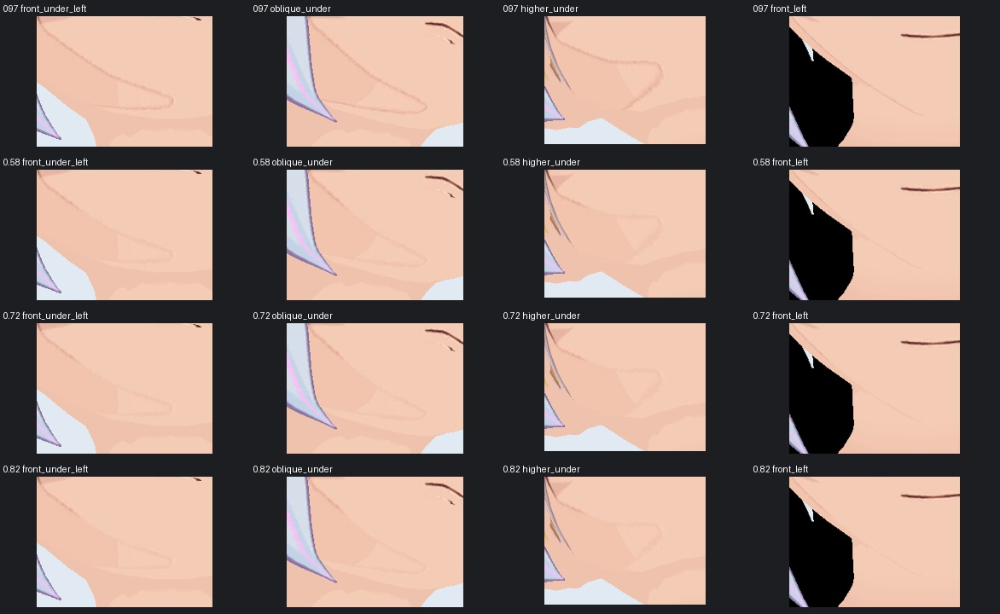
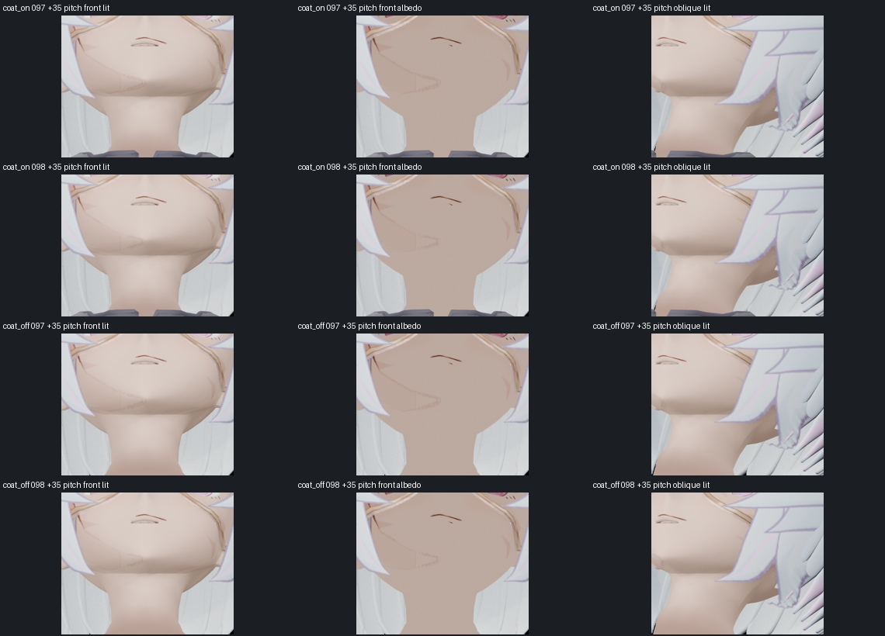

# 白绮 098 仰视下颌颌缘过渡

097 降下颌大色斑后，纯底色图中仍能看到一段细红描线。将屏幕像素投回 UV，定位到原画颌缘的半透明边。分层对照显示 `ArtMesh54` 的颜色参与了这段边缘。局部取该层的颜色差，向下颌侧渐变衰减，保留五种表情的原透明度。

对比 58%、72%、82% 和完全减弱。完全减弱时，部分仰视机位出现浅色反边，选用 72%。正面仰视底色的固定测区中，红绿通道差至少为 45 的像素由 890 降至 138。斜仰视由 1,240 降至 192。+35° 仰头的 Blender 正面、斜面图也复看了颌缘过渡，轻微原画痕迹在纯底色下仍可辨认。

每种表情只改原图的 215 个像素。原生输入中五张脸部底色各改 739 个纹素，其余 98 张贴图哈希一致。原嘴部、鼻部法线、眼镜、头脸及 CC0 身体几何通过逐项检查，两份 FBX 的位置、拓扑、UV 和区段均相同。

两种形态各复验 33 组动作和 197 个姿态，数据与 097 逐项一致。原 CC0 记录各 20 项，新增标记各 0 项。UE 5.7.4 读回两套 348 骨网格和四种眼部切换，50 张常规图及 24 张低角度图通过复查。6000D 回收两种形态的 16 张仰头动作图。

复现从 097 五张源图运行 `scripts/bake_baiqi_underjaw_tint.py --edge --amount .72`，再将结果通过 `scripts/apply_baiqi_eye_glints.py --underjaw-edge` 写入两套工程。097 的原始底色工作流已逐文件复验。

