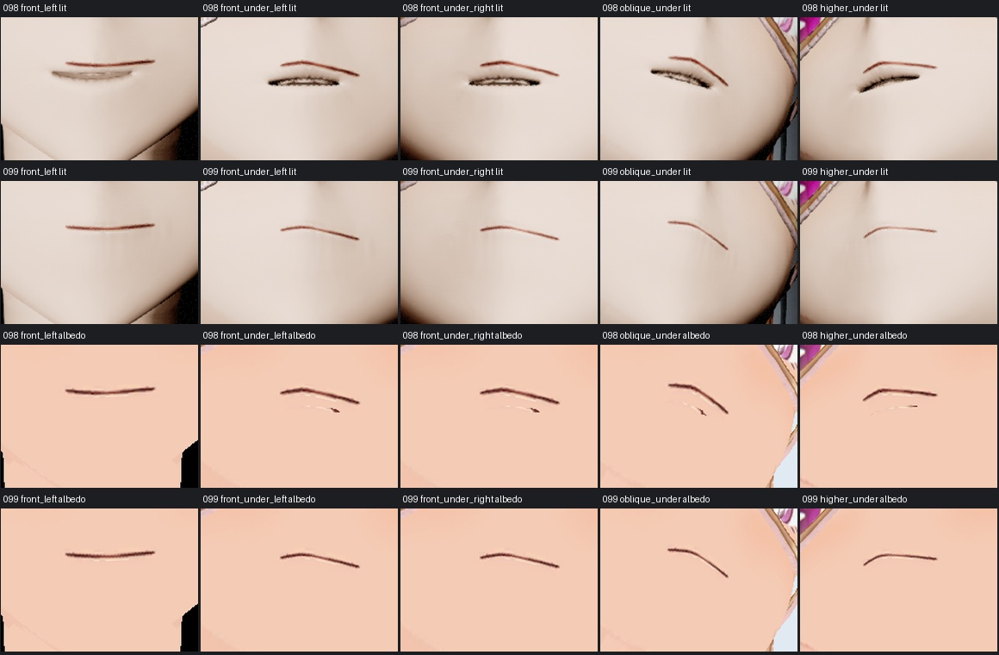
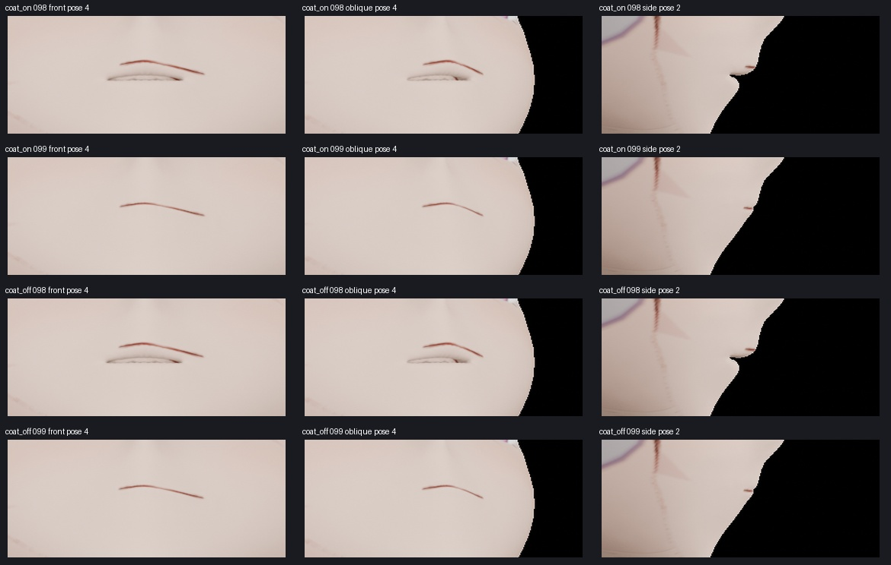

# 白绮 099 原模闭口嘴部设计

098 仰头时出现上下两条线。拆成底色和灰模后，确认上方是 Live2D 默认嘴线，下方是旧三维口缝。原画主线由 `Mouth2` 提供，原图范围 x=412–466、y=533–535。旧网格开口由 64 条边围成，投影落在 y=540.1–541.8，开口内还有多层旧口腔网格。

先比较移动原画、推平旧口部和封住开口。移动纹理在仰视时能合并两道线，但正面保留旧口缝的边缘毛糙。单独封口后还有一段浅折线。采用沿原画唇线重做局部闭口曲面，把主要唇缝落在原来的嘴角和线条上。比较平面、0.72 毫米和 1.1 毫米唇缝起伏，采用 0.72 毫米，在唇线附近保留浅体积。

两种形态各替换唇周 1,043 个原面，用 45 条原边界边连接 2,053 个新三角面。对比更密的曲面后，选取在唇线附近加密的版本。新唇面全部使用原头部权重，静态与旧口腔内层相交三角对为 0。FBX 内差异位于原图 UV 的 x=377.8–480.2、y=523.7–565.1，区域外多边形、位置、UV 和材质经逐项核对一致。103 张原生贴图的哈希一致，默认嘴的原图色彩和闭口神态保留。

Unreal 的同机位低位主光下，脱外套版正面仰视原旧唇缝在固定亮度阈值内的暗像素从 715、618 降至 1、0。斜仰视由 592 降至 212，仍可看到唇周自然转折。两种形态的正视和仰视均读到一条唇线。另隐藏发片和眼镜检查侧面，原口部的深凹变为连续闭口轮廓，侧面唇部体积仍偏轻。

本机两种形态各通过 33 组动作与 197 个姿态复查，数据与 098 一致，原 CC0 记录各 20 项、新增标记各 0 项。对照包含转头、仰头和双刀出招。UE 5.7.4 读回两套 348 骨网格与四种眼部切换，常规图 50 张、低角度图 24 张，6000D 回收两种形态共 32 张动作图。

使用 `scripts/refit_baiqi_closed_mouth.py` 处理 098 双工程及其烘焙清单，后续沿用 098 的贴图输入和原生烘焙。当前为独立离线候选。

