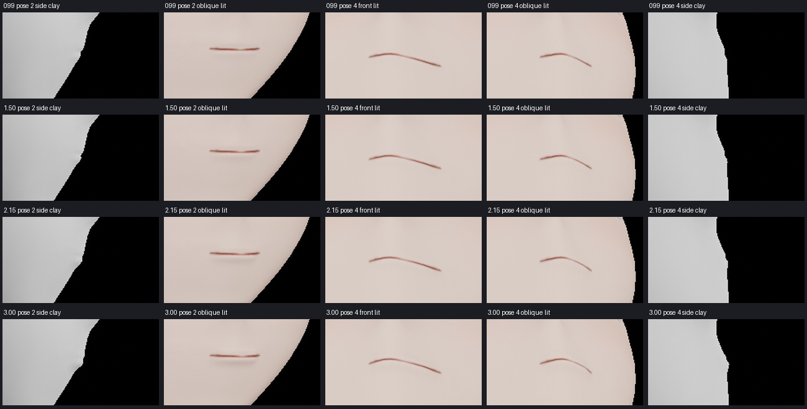
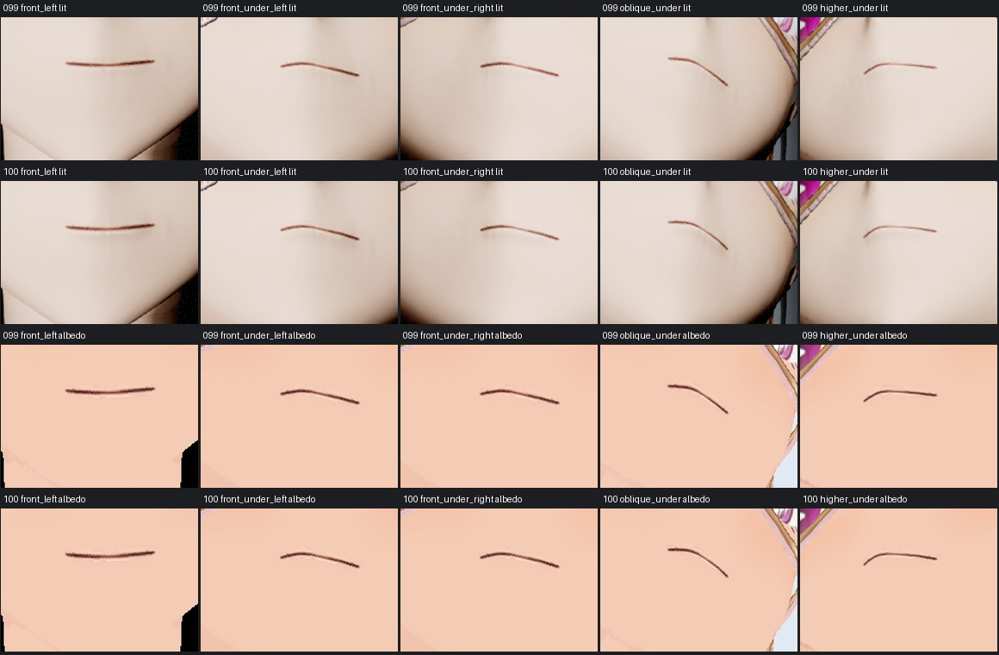
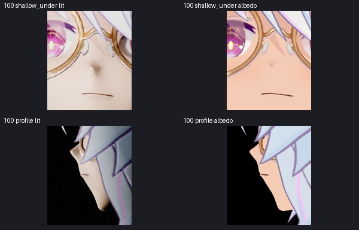

# 白绮 100 闭口侧面体积

099 消除了仰视时的双线，侧面唇周偏平。保持 Live2D 默认嘴的线条、嘴角和 0.72 毫米唇缝参数，比较上唇和下唇起伏同时增加至 1.50、2.15、3.00 倍。最强档的仰视侧面有突尖，中间档的闭口轮廓稍饱满。使用 `scripts/refit_baiqi_closed_mouth.py --lip-volume-scale 2.15` 从 098 的双工程生成，沿用 099 的贴图和烘焙设置。

中间档的上唇起伏参数由 0.31 增至 0.67 毫米，下唇由 0.55 增至 1.18 毫米。960 像素侧面灰模上，唇周轮廓最多向前移动 3 像素。对比 099，两个 FBX 各有 1,169 个三维面的位置变化，原图 UV 范围在 x=408.2–470.0、y=523.7–552.5。所有区域外的多边形、UV 与材质逐项一致。103 张原生图的哈希全部一致。闭口面与口腔内层相交计数为 0。原 CC0 身体、骨架和唇周以外的头脸皆保留。

UE 同机位低位主光对照里，下唇局部阴影略加强。脱外套版正面仰视原异常折线测区暗像素在两侧主光下分别为 59 和 0，斜仰视为 326，基准 098 三个测区分别为 715、618 和 592。固定角度图中唇线仍连续，底色层未出现第二线。标准预览有 50 张图，嘴部预设有 32 张图，覆盖约 20°、29°、35°、42° 仰视。预设的 24 张共用机位与原诊断脚本逐像素一致。

本机两种形态分别验收 33 组动作、197 个姿态。全部数值与 099 一致，每种保留 20 项 CC0 记录，新增标记 0 项。6000D 回收 64 张仰头及双刀出招的灰模和受光图。UE 5.7.4 读回两套 348 骨网格和各四项眼部切换。当前为离线候选。

