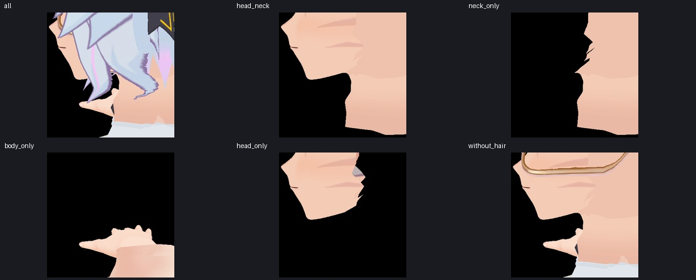

# 白绮 100 侧视下颌分区复查

Unreal 嘴部预设的 90° 侧视中，下颌下方可见一处带指甲的皮肤色投影。固定相机，以底色分别显示完整形态、CC0 身体、白绮头部和补颈。仅显示 CC0 身体时投影仍可见，同时显示白绮头部和补颈时该投影消失。拉远相机可以看见参考姿态里两臂平伸，远侧手部与颈部在纯侧面发生投影重合。

两种形态使用相同的参考姿态。动作套组的放下手臂及仰头画面用于复核颈部，CC0 身体未修改。

