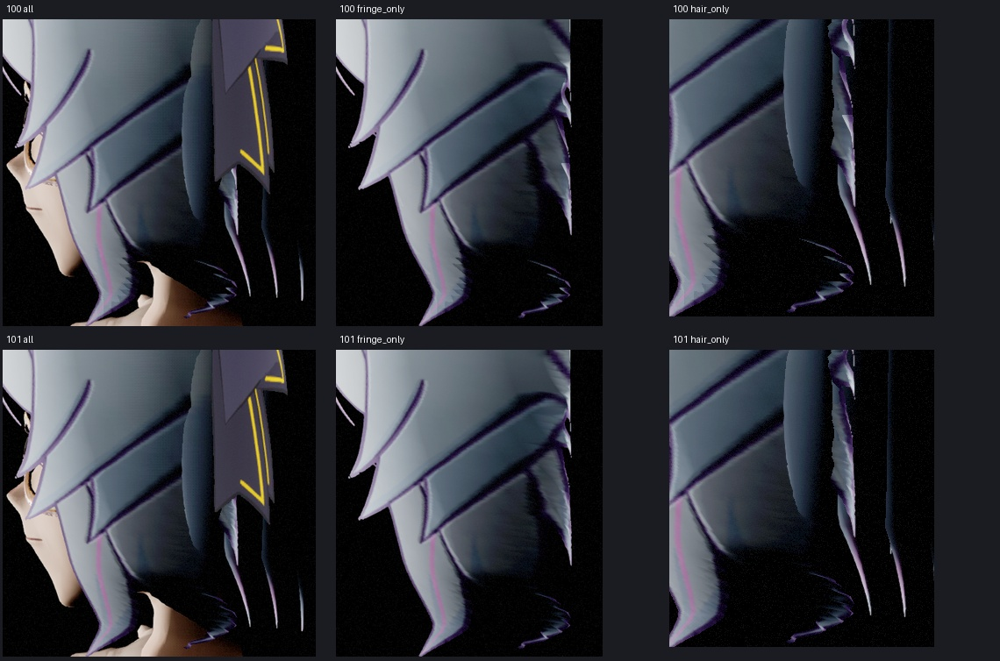

# 白绮 101 前发裁切接边

100 纯侧面低位主光下，耳侧长发背缘有一排尖齿。将刘海、发底和后发分别单独显示，尖齿在单独显示前发时仍出现。用色值编码 UV 的临时贴图把问题定位到原图下侧发束，原图线条和透明轮廓在该处连续。

导出裁切会按透明阈值细分边缘三角面。邻接的整面可能仍使用原长边，形成 T 形接边，打断受光的平滑过渡。前发在原生输入是单层。裁切后测出 570 处短边与长边不对齐，其中 68 处落在侧下发束的 UV 测区。把细分中点同步给相邻整面后，两项计数都降为 0。颜色图、透明阈值、原发片形状和原图映射沿用 100。

Unreal 同机位前发分区图中，侧下发束原来的连续硬尖齿减弱。固定测区 2,967 个样本沿纵向的亮度二阶差分，第 95 百分位由 26.0 降到 21.5，超过 10 个亮度单位的样本从 790 降到 594。最靠后的发梢仍有少量尖边。两套 FBX 都只改变前发区段，面数由 12,345 变为 14,011，区段外的面、位置、材质与 UV 精确一致。两套 Blender 工程和 103 张原生图的哈希都与 100 相同。

两种形态各按 33 组动作、197 个姿态复验，结果与 100 一致，各保留 20 项 CC0 记录，新增标记为 0。6000D 回收 48 张仰头和转头的侧面、斜面图。UE 5.7.4 读回两套 348 骨网格和各四项眼部切换，复看常规 50 张图及嘴部预设的 32 张图。四个深仰视机位的唇线测区和 100 的底色逐像素一致，受光单通道差至多为 1。当前为离线候选。

复现时对 100 的双工程用 `scripts/export_baiqi_game_forms.py --conform-fringe-edges`，同时启用既有 `--bake-alpha-geometry` 参数，然后沿用 100 的材质烘焙。

