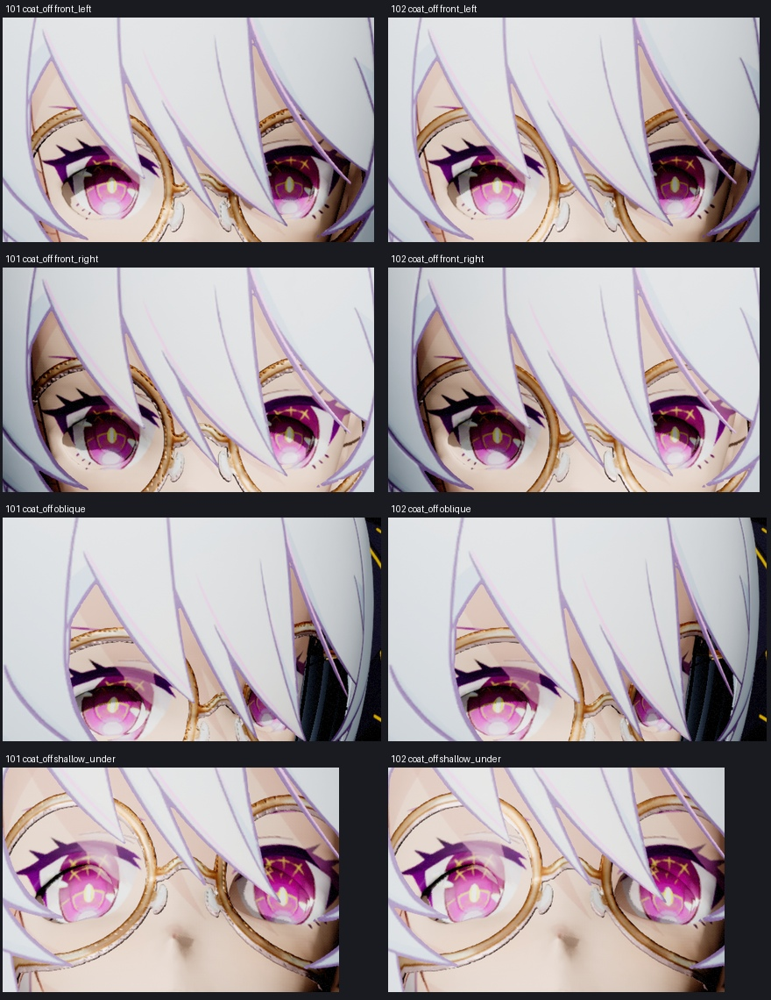

# 白绮 102 金色镜框裁切接边

101 的镜框在正面及浅仰视受光图里出现碎亮点。拆开底色和受光图对照，原色图里的金线较连续。测得镜框透明裁切后有 508 处 T 形接边。镜框需要厚度，原流程给这些错开的长短边额外生成了 1,524 个侧壁面。把相邻三角面的细分中点对齐后，T 形接边计数归零，透明阈值和原金色图沿用 101。

把修复前后的镜框放在同一双形态场景，核对正面两侧照明、斜视和 20° 仰视。碎亮点变为更连续的弧形反光。固定浅仰视差异测区中，脱外套版低于 100 的像素由 893 降为 770，亮于或等于 220 的像素由 223 增为 595。增加的高光沿弧线聚拢，较斜的机位高光覆盖收窄。仍能读到鼻托与金圈各自的材质。

两种形态的 FBX 各仅修改圆镜框区段，加厚后面数由 11,269 变为 12,773。镜框以外的位置、UV、区段与多边形逐项一致，103 张原生图和两份 Blender 工程的哈希与 101 一致。

双形态各复验 33 组动作、197 个姿态，数值与 101 一致，各保留 20 项 CC0 记录，新增标记为 0。6000D 复看转头和双刀出招的 48 张图。UE 5.7.4 读回双形态 348 骨、四种眼部切换，出 50 张常规图和 32 张嘴部预设图。当前为离线候选。

以 101 的双工程复现，导出保持 `--bake-alpha-geometry --conform-fringe-edges`，增加 `--conform-frame-edges`。其余烘焙参数沿用 101。

