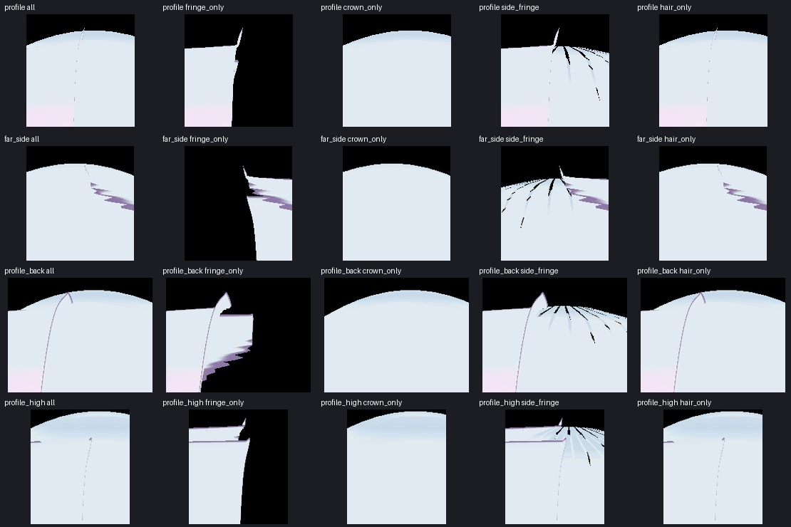
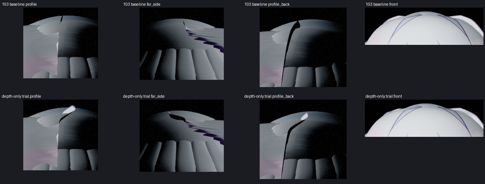

# 白绮 103 头顶侧视复查

在纯侧面和偏后约 8° 的低位打光下，头顶可见一段黑边。用底色分别显示前发、发底和后发，确认发底完整覆盖这一带。黑边对应原画前发顶部的发峰。以 103 的相同相机关闭投影，固定测区仍有 89 个亮度低于 20 的像素。

对照了三个局部方案。将发峰最多压低 3.4 毫米后，纯侧面测区暗像素从 89 降到 69，原画正面发峰高度也发生变化。三个贴图法线方向各得到 88 或 89 个暗像素。沿前后方向把前发顶部最多收进 12 毫米后，纯侧面测区降到 46，另一侧出现更显眼的深边，偏后机位仍保留原暗带。保留 103 的头顶几何与贴图。

