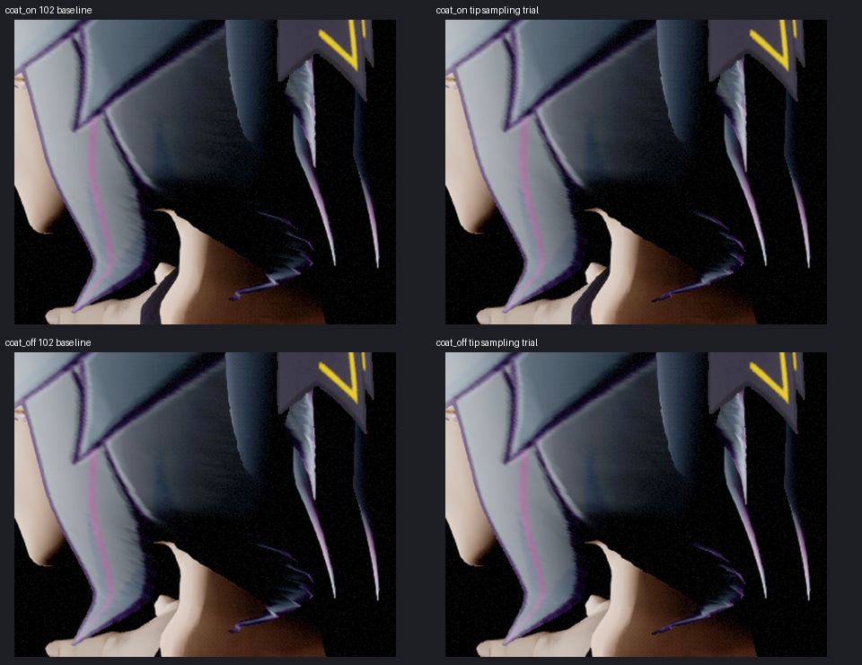
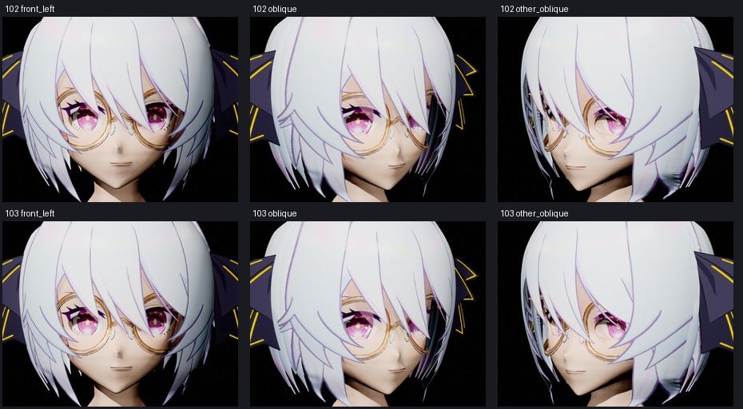

# 白绮 103 耳侧发梢采样

102 纯侧面低位照明里，后侧发梢还有短折边。前发裁切已共享三角边中点，本轮只对该束发梢细化裁切前的取样。原图 x=545–666、y=525–625 及其相邻边界的 384 条边各细分一次，继续使用相同的透明阈值。前发在 Unreal 两种形态的纯侧面里出现更连续的亮暗变化，后侧发梢的硬折减弱。

两种形态 FBX 的变化集中在前发区段。前发面数由 14,011 增为 15,484，其中 13,141 个原面逐项一致。其余区段的面、位置、UV 和材质一致。两套 Blender 工程和 103 张原生贴图的哈希与 102 一致。

两种形态的 33 组动作和 197 个姿态各自与 102 一致。原 CC0 记录各 20 项，新增标记各 0 项。6000D 复看转头、仰头的侧面和斜面共 48 张图。UE 5.7.4 读回 348 骨和四种眼部切换，使用仓库内的 `regression` 和 `mouth` 预设复看常规 50 张图和嘴部 32 张图。当前为离线候选。

复现时在 102 的导出参数上增加 `scripts/export_baiqi_game_forms.py --refine-fringe-tip`。材质烘焙沿用 102。

