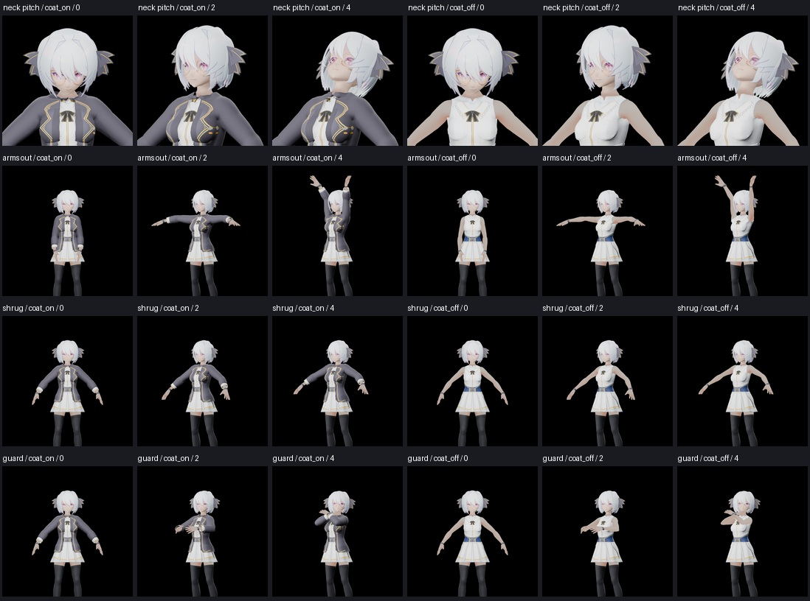
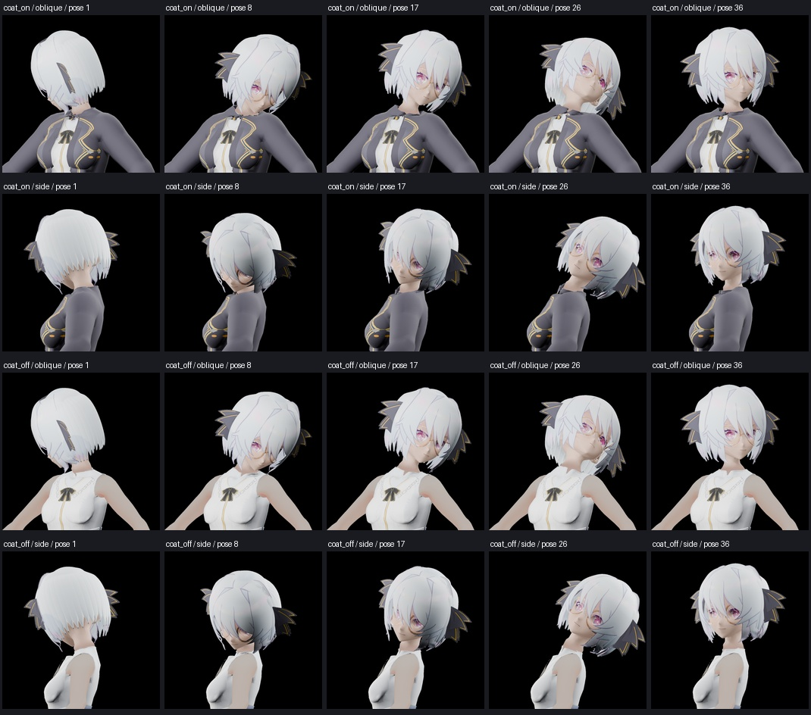
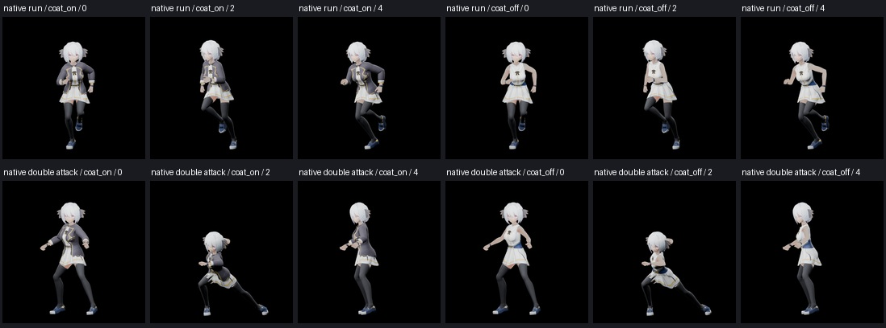

# 白绮 103 双形态复查

以 `ae103ec` 对应的两份完整工程作为当前离线版本。每套均已有 33 组动作、197 个姿态数值记录，包含各 20 项 CC0 继承记录和 0 项新增标记。Unreal 常规回归与嘴部预设共 82 张图，覆盖双形态、眼部状态切换、正面、侧面和约 20° 至 42° 仰视。嘴线继续使用 100 的闭口曲面。四个仰视机位的唇线测区底色与 102 逐像素一致，受光单通道差至多 1。

在 6000D 补做 184 张对照。144 张来自仰头、双臂外展、耸肩、交叉防御、原生跑步和双刀出招，使用正视、斜视和三个采样点。另有 40 张来自 37 姿态组合颈姿的第 1、8、17、26、36 号采样，从侧面与斜视复看颈根、领口和下颌。已抽看两种形态的对应图。大角度处的领口接触留在内缘，抽取的跑步和出招没有出现新的肩臂或外套异常。纯侧面参考姿态的手部投影单独记录在案。[参考姿态分区](baiqi_100_profile_projection.md)

组合颈姿第 1 号斜视只看到近侧发饰的一段。对游戏阈值裁切后的网格作交叉检查，发饰与前发、后发的相交三角面均集中在离头部中线约 120–132 毫米的固定处。发饰向外延伸至约 192–206 毫米，145 毫米以外相交计数为 0。保留当前发饰的位置。头顶极端侧后光仍可见原画发峰的窄暗边。本轮三种方案在原画正面轮廓或另一侧引入了代价，保留 103 的头顶造型。[头顶试验记录](baiqi_103_crown_profile_review.md)

103 为已归档的离线候选，正式发行的实际游戏画面保留独立验收记录。

