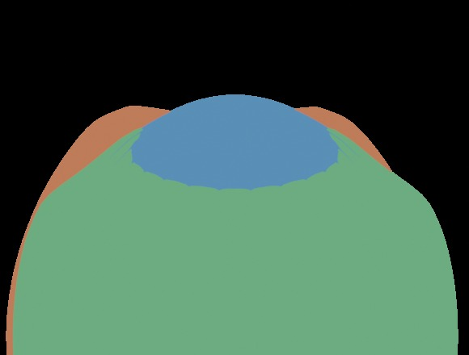
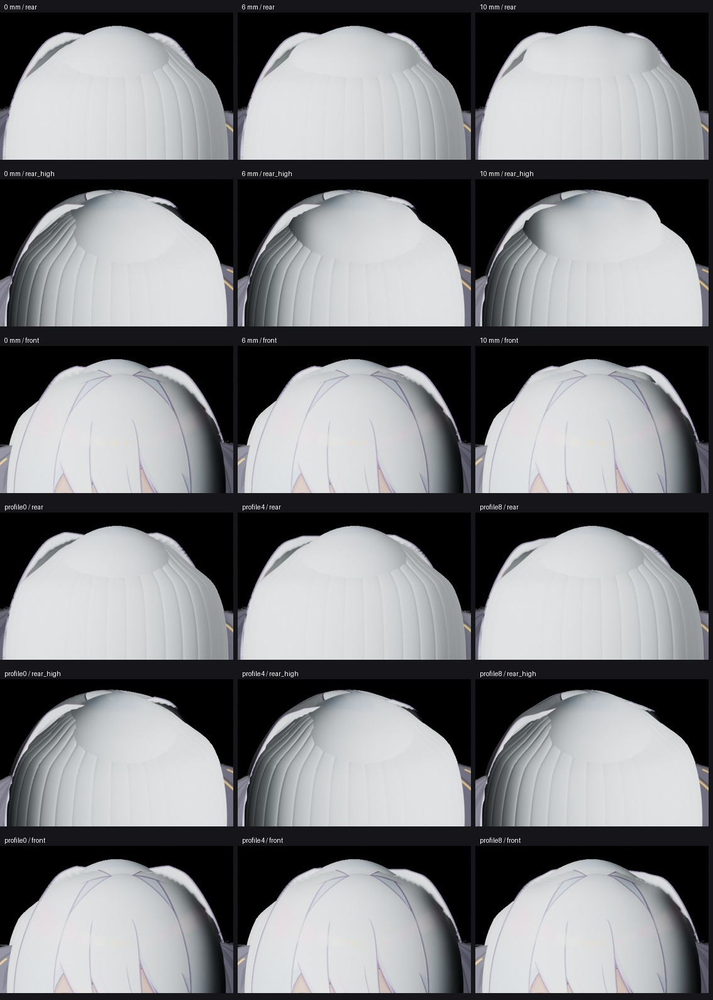

# 白绮头顶接合试验

从后方能看到前发两侧上缘与头顶发帽之间有暗带。分件纯色图显示暗处是前发背面。游戏原 `MAI_Cloth` 的提取记录启用了双面覆盖，白绮的材质实例继承它。离线项目的占位父材质使用默认单面值，直接查看占位值会遗漏原材质的双面设置。 [Unreal 材质实例属性](https://dev.epicgames.com/documentation/en-us/unreal-engine/python-api/class/MaterialInstanceBasePropertyOverrides?application_version=5.7)

整段抬高发帽的试验缩减了后方暗带，也使发帽顶部显得更鼓。前半侧局部抬起试验对后视暗带影响很小。压低前发两侧上缘时，较轻的一档使固定后视区域中亮度低于 155 的像素从 1,330 降到 1,035，正面上部轮廓掩膜的交并比为 97.57%。更强的压低在正面更明显。当前 081 保留已确认的头顶和刘海轮廓。

