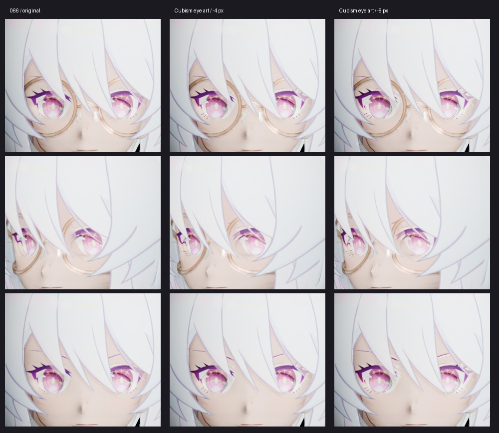

# 白绮眼位横移试验

原图中性双眼的虹膜中心在 880 × 800 色图上约为 x=358.50 和 522.22。用各眼贴图自身的像素范围取样，会得出较大的左右前后差。按头部左右各 35 至 51 毫米的对应坐标重算，四个高度的最大前后差为 0.24 至 0.29 毫米。剩余一条在眼皮局部为 2.68 毫米，采样两侧同时有最高约 0.63 毫米的高度差。

保持头部网格和眼睛原光泽试验的控制条件，将 Live2D `Eyes` 子树和它的裁切遮罩在 Cubism 出图时整体向左平移 4 或 8 个像素。正面、中近斜角和隐藏镜框的对照沿用同一灯光。平移后部分睫毛和外眼角更靠近镜框边，原眼区和镜框的关系没有可见收益。因此采用 066 原眼位，后续继续比较虹膜和面部对光的反应。

[配对截面和原画中心数据](../figures/baiqi_eye_registration_066/matched_world_metrics.json)
