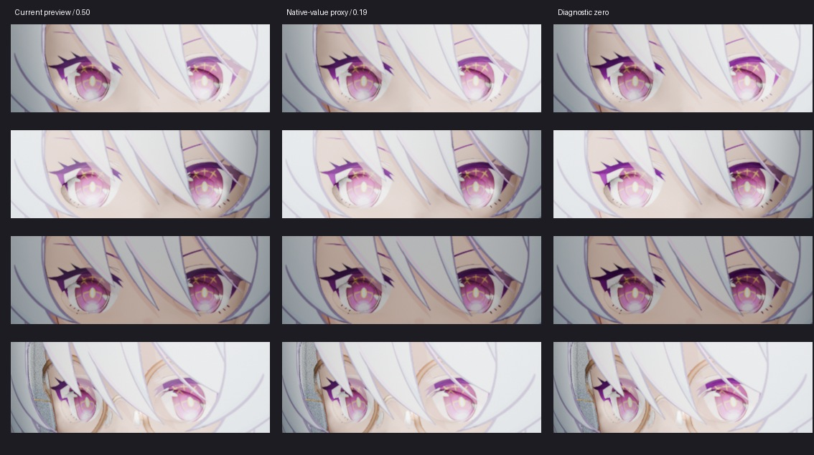

# 白绮眼部镜面反射试验

067 的眼睛在某些灯位仍能看到一大片亮区。固定相机、色图、法线、粗糙度和灯位，将 Blender 眼部的镜面系数从原预览值 0.50 改到 UE 材质已使用的 0.19，再单独测试 0。后两组均为 Blender 诊断，实际游戏光照另验。

在覆盖两枚可见虹膜的固定区域内，左右主光的高亮像素数在较高阈值 218 处有下降。降到 0 后，较低阈值 205 的亮区像素数仍保留原值的 96% 和 98%。左光平均显示亮度只有约 0.48 的变化，右光约 1.29。说明镜反射会推高峰值，剩余大片亮区还受底色和其他受光项影响。保持已导入的 UE 镜面参数，原对照作为下一轮材质诊断的依据。 [Epic 材质输入说明](https://dev.epicgames.com/documentation/en-us/unreal-engine/material-inputs-in-unreal-engine)

[固定区域像素数据](../figures/baiqi_eye_specular_067/eye_specular_metrics.json)
