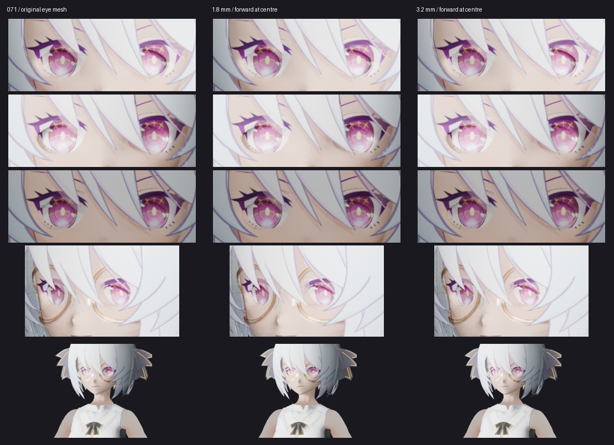

# 白绮眼窝局部曲面试验

沿原眼白的五条横截线取样，用眼白两侧连线对比中央深度。中间数行的眼窝中央约深 3.8 到 4.8 毫米，上方个别截线达到 8.7 毫米。这里的深度是局部截面量，屏幕上的体积还受眼睛原画、镜框、刘海和灯光影响。

按原眼白轮廓调整眼窝中央前向位置，试验上限 1.8 与 3.2 毫米，力度向边缘衰减。两档在特写有少量眼面反光变化，半身距差别很小。保持 071 的原眼型和权重，留下试验数据作为后续眼部调优依据。

[两侧截面和中心深度](../figures/baiqi_eye_surface_071/eye_socket_depth.json)
