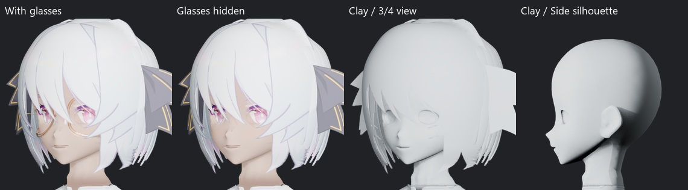
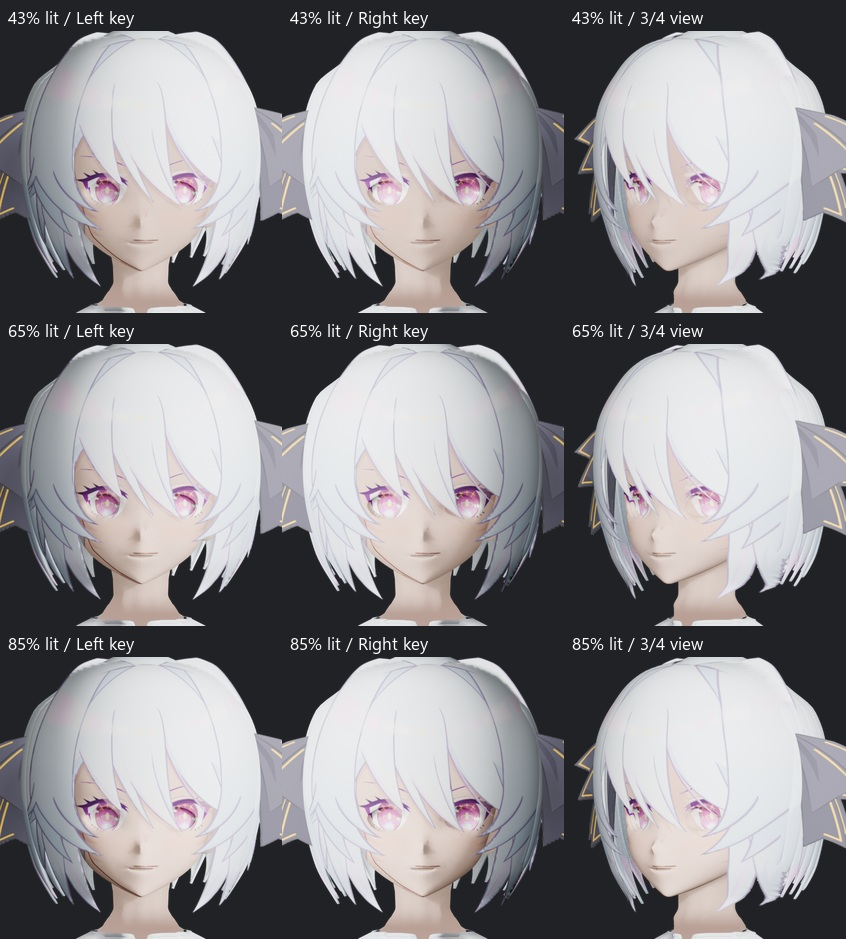
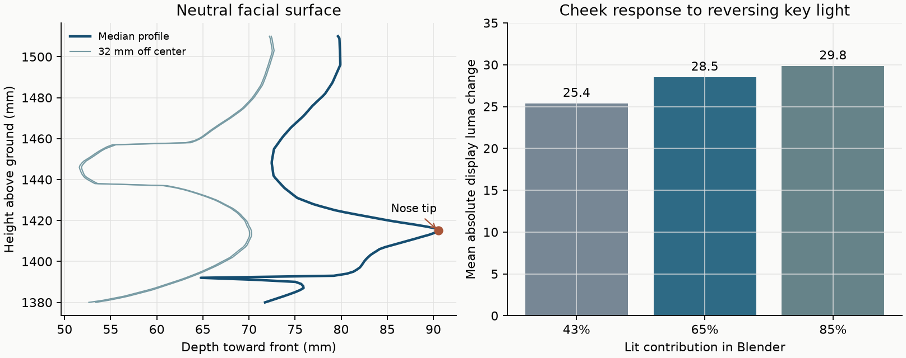

# 白绮面部扁平感专项分析

## 结论

下一轮优先做**游戏可用的皮肤明暗过渡和眼周分层**。现有头型已经有足够清楚的鼻尖、眼眶和下颌，最明显的扁平感出现在带贴图的正面与斜面。此处既有皮肤对方向光的反应偏弱，也有虹膜亮斑、睫毛和圆镜框的高对比抢走了注意力。单靠增加三角面，或统一加亮整张脸，难以解决这两个因素。

本次用 059 脱外套工程做只读实验，头部几何、肤色和原嘴部保持固定。060 的中性头脸几何和原有烘焙图与 059 一致。实机参考仍来自已安装的 054。以下受光比例是 Blender 材质实验参数，UE 使用的独立原生材质需要单独对照。

## 一、灰模有体积，带贴图时中面部显平

隐藏头发和眼镜后，侧面灰模能看清鼻尖、嘴唇和下颌，前斜灰模也能辨认鼻翼与眼眶。正中截面在鼻尖高度量到前向坐标 90.5 毫米，两侧离中心 32 毫米的皮肤为 70.0 和 70.3 毫米。鼻尖有约 20 毫米的横向深度差，面部原有的鼻、下颌大形体已经存在。眼球和眼睑的微小起伏仍有改善空间，后续可用近景灰模验证局部需求。此阶段应保留用户已确认的脸型和嘴部。

## 二、面颊的方向光反应有改善空间

固定相机、颜色、填充光和网格，只将主光从左换到右。用四个面颊区域各 9 × 9 像素，量化两张渲染的平均绝对显示亮度变化。皮肤受光比例从 43% 提到 65% 时，变化由 25.4 增至 28.5，约提高 12%。再升至 85% 时为 29.8，收益变小。65% 图的鼻翼和脸颊过渡已更容易分辨，85% 图在本灯位下把正面亮区推得更白。这个测试只说明当前造型可从更清晰的明暗过渡获益，数值受本组灯光与曝光影响。脸和补颈使用同一肤色基准，也要在同一灯位核验颈部接缝。

## 三、眼区高光和轮廓是另一项独立问题

去掉眼镜后，眼周少了一层抢眼的线，虹膜里的大片白色亮斑仍在。对照左右主光，亮斑持续跟着眼睛贴图的固定位置。060 的眼部切换增加了眨眼和视线状态，原本的亮斑仍随状态图一起切换。其粗糙度遮罩能改变材质响应，原烘焙在颜色中的亮斑需要在虹膜层单独处理。先保留白绮的粉色虹膜、睫毛线和代表性高光形状，再对比少量削弱固定白斑与由灯光生成的高光。镜框应保持细且有金属反光，免得与眼睛争亮。

## 下一轮的优先顺序

1. **先做 UE 的皮肤单变量试验。** 在相同的 060 网格、脸图和机位上沿用已有的材质实例分层，单独调整皮肤的明暗过渡，比较正光、侧光、逆光。目标是鼻翼、颧面和下唇下方能读出层次，同时保持原肤色基准、淡化脸颈分区感。054 的实机皮肤走原生布料材质，不能直接照搬 Blender 的混合百分比。 [Epic PBR 材质说明](https://dev.epicgames.com/documentation/en-us/unreal-engine/physically-based-materials-in-unreal-engine?application_version=5.7)
2. **再做眼睛的动态受光。** 分开对照原眼图、轻微削弱固定高光的眼图、材质产生的高光。用有眼镜和临时隐藏眼镜的同机位双组图，在换灯时判断眼睛是否更有深度，又仍然像白绮。
3. **最后才考虑局部几何。** 如果调整材质后，近景仍看不清上眼睑与眼球的前后关系，再用极小范围处理眼睑边缘，保留原脸部轮廓与嘴部。用半身和特写检查约束。普通游玩距离以脸和脖子整体体积清楚为主，特写再看眼周和镜框。

保留的证据包括七条面部截线、四个面颊取样位置、同机位前斜侧渲染和 054 换装截图。本次只保存诊断图和数据，候选模型留在现有版本。 [面颊数据](../figures/baiqi_face_depth_060/face_depth_metrics.json) · [面部截线](../figures/baiqi_face_depth_060/sagittal_profiles.csv)
