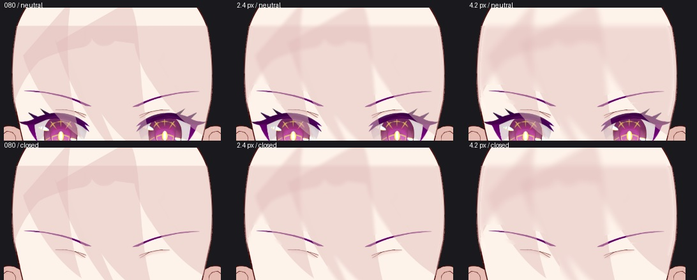
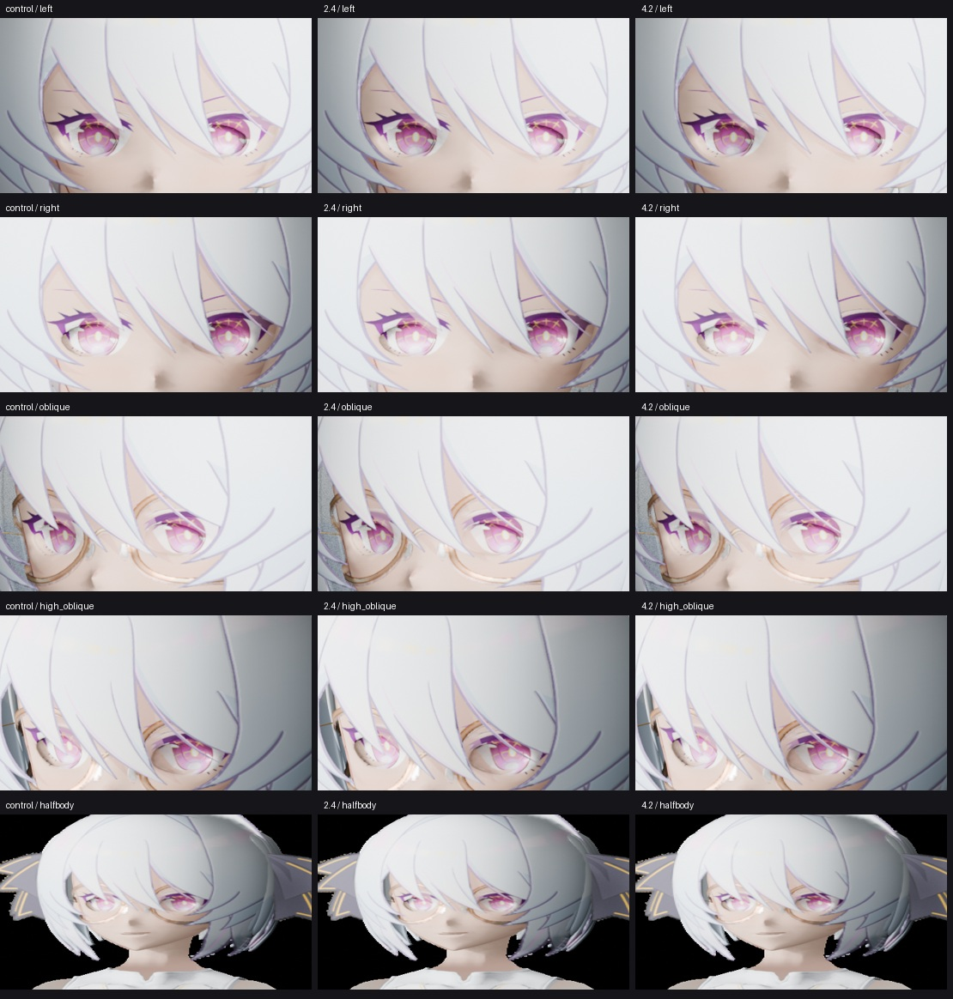

# 白绮额头原画阴影试验

分层检查后，额头上三角形的明暗过渡来自 `ArtMesh18`、`ArtMesh20`、`ArtMesh22`、`ArtMesh25`、`ArtMesh27` 五层刘海阴影。下巴描边另有自己的图层。试验只把这五层已经画入脸图的过渡做 2.4 和 4.2 像素羽化，保留眼睛、眉毛、原嘴部、鼻尖校准和脸部边界。两档都保留现有肤色基准。

脱离发片的脸图里，过渡变柔和。戴上原发型后，多数变化被刘海遮住。较强档在 Blender 固定斜视近景有 249 个像素变化超过 2 级，在半身图只有 34 个。各对照镜头都没有超过 8 级的像素变化。维持 080 的面部贴图，结束这次羽化试验。

