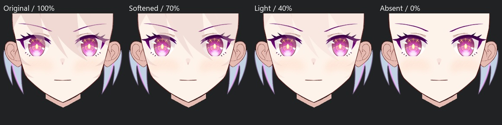
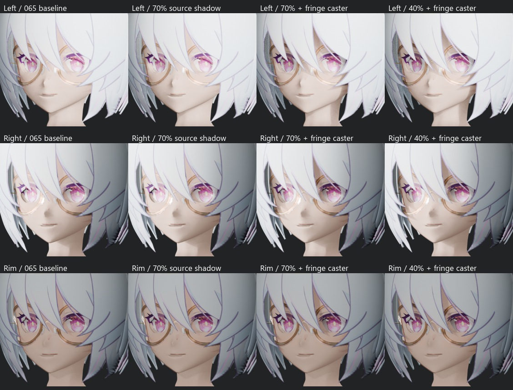

# 白绮 065 刘海阴影诊断

在原 Live2D 中分离了五张裁到脸面的刘海阴影图层。其边缘和眼周高光重叠。以 065 的发型和原脸为控制组，试了源阴影 70%、40% 和开启真实刘海投影的组合。贴图试验保留完全覆盖的眼区及图像第 517 行以下的原像素，原嘴部保持一致。试验在临时渲染场景完成，055 至 065 存档均保持原样。

只将原画阴影调到 70% 时，包含眼周的取样区域在三灯位的平均显示亮度变化约为 +0.1。启用刘海真实投影后，同一区域在左光、右光和轮廓光下分别约为 -7.4、-4.4 和 -2.3，左主光最暗 5% 像素的变化约为 -46.9。原画变化大多在刘海覆盖之下。打开整片刘海投影会明显压暗眼周，40% 与 70% 对该现象的影响很小。

本试验留作诊断。当前候选为 065。后续脸部受光可按鼻侧、眼睑和颈部接合分别试验，以免用整片阴影盖住原来的眼睛细节。
