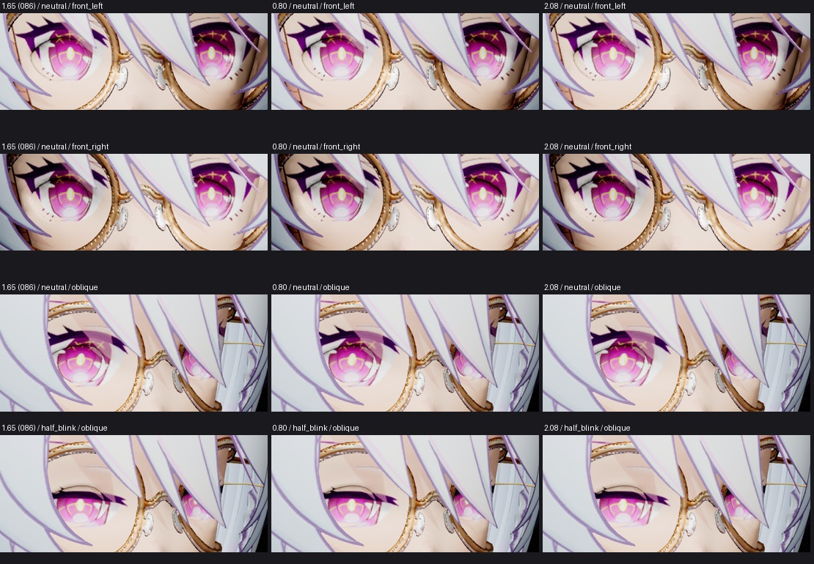

# 086 虹膜法线幅度复验

在 086 的同一几何和原画上，把虹膜局部法线幅度从 1.65 分别改为 0.80 与 2.08。每次只重烘虹膜所在的局部法线。观察两种形态在中性和半眨眼状态下的左右主光与斜视图，并用 Unreal 的 Mix 诊断图圈定可见虹膜。

0.80 在半眨眼的两个正视灯位上减少了较亮的一小片。以显示亮度 220 为阈值，脱外套两图分别由 848 降至 814、由 631 降至 616。中性和半眨眼斜面没有一致下降，测得的脱外套虹膜中位亮度最大变化为 0.50。2.08 在部分灯位扩大亮区。保留 086 的 1.65 幅度。

