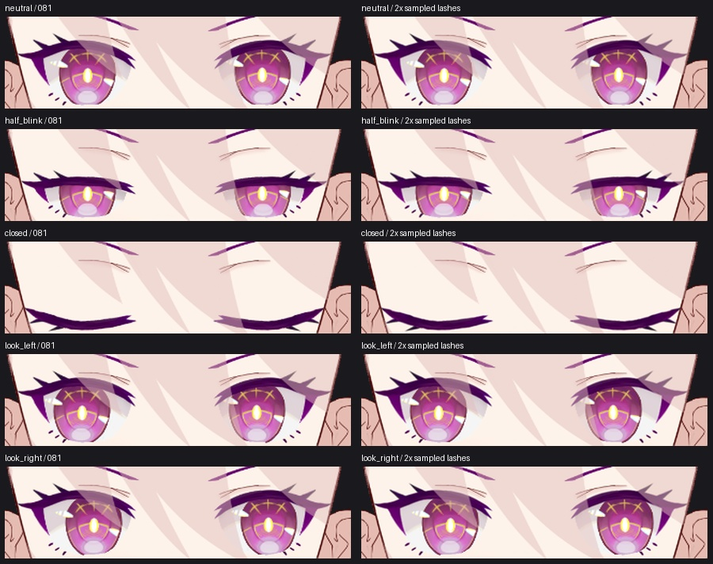

# 白绮眼睫采样精度试验

用原 Live2D 图集直接渲染截取的脸部区域，比较原采样和双倍采样后缩回原图尺寸。将两者的局部差值限制在原眼睫覆盖范围内，保留肤色、瞳孔、嘴部和其他区域。五种状态的改动量为 1,403 到 1,496 个源图像素，集中在眼睫边缘。

放大的图集可见边缘采样差别。同机位 Blender 正面左右侧光下，分别有 55 和 53 个像素的通道变化超过 5 级。戴眼镜斜视有 34 个像素，半身图为 0 个。081 的人物材质继续使用当前采样结果。

