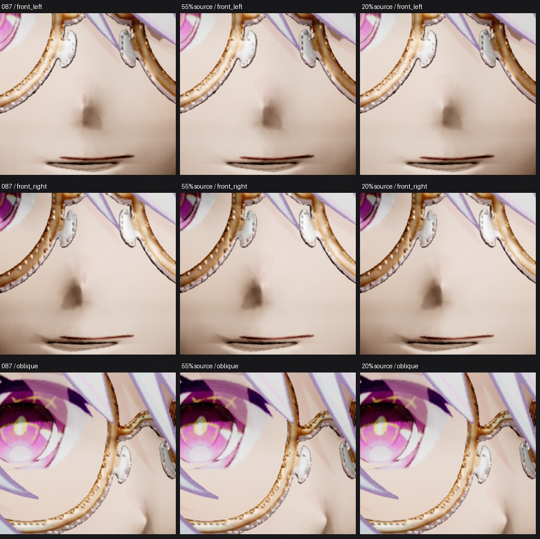
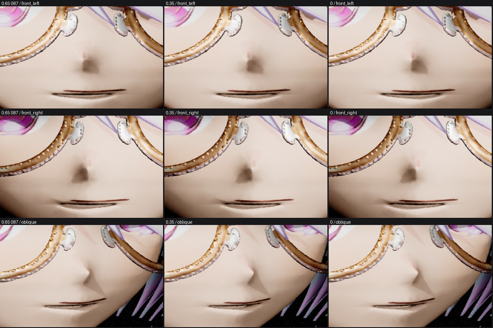

# 087 鼻部受光复验

用打包分区投影设置检查鼻部。首先只改变原画细线 `Nose2` 的透明度，保留已经对齐的鼻纹主体 `ArtMesh106`。两档各影响 33 个源像素。在脱外套三个近景机位，保留 55% 时分别只有 56、46、37 个像素的单通道差大于 6。粉色细线减弱，鼻下暗部仍在。

随后只把鼻部法线幅度从 0.65 降至 0.35 或 0，面颊、虹膜和色图保持原样。以脱外套三个固定鼻部测区为例，0.35 档的亮度低于 100 的像素由 2、133、11 变为 7、116、6。零幅度档分别为 16、104、2。两档都无法稳定减轻三个机位的最深暗部。观察到的鼻下暗部随灯位移动，保留 087 的鼻部原画和法线。

