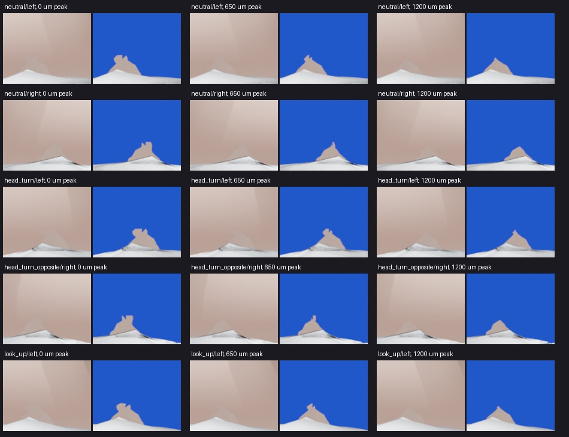
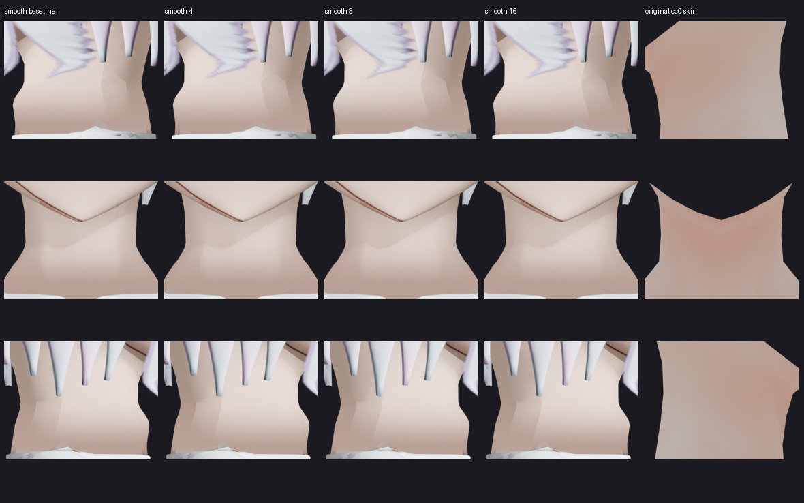

# 白绮 068 侧颈表面试验

068 静态侧面另有一枚很小的三角肤色块。用材质分层和相机射线对照，这个位置命中原 CC0 身体的可见皮肤。两处取样比白绮补颈的外表面靠外约 0.10 和 0.31 毫米。该处是两个表面的交接，形成原因与 068 已处理的领口穿插不同。

将补颈侧面局部外扩约 0.65 或 1.20 毫米作为试验，两档均能缩小色块，仍能观察到三角残留。高档在两侧中性视图的固定测区中分别少了 124 和 109 个暖色像素。最终保留 068 网格，避免为放大图中的色块继续加宽领口附近的补颈。

关闭投影后，侧颈的硬折线仍能看到，关闭皮肤受光后折线消失。4、8、16 次局部法线平滑，以及限制在 1.10 毫米内的截面圆滑，都没有去掉折线，常看距离的收益不足。记录原 CC0 对照和测试图，生产模型保持 068。

