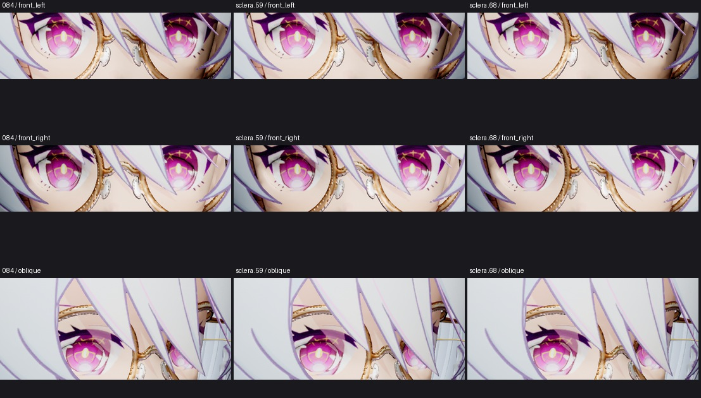

# 084 眼白粗糙度复验

同步导入材质纹理后，用 084 复测原眼白遮罩内的粗糙度。两档分别将局部粗糙度提高至 0.59 与 0.68，覆盖取自原眼白，避开遮罩中的虹膜。闭眼图、颜色、法线、金属度和其他材质保持原样。

双形态的中性与半眨眼各看正面左右灯、斜视和斜后视。以脱外套中性为例，0.68 档在前三个机位上有 334、297、251 个像素的单通道差大于 4。其中显示亮度上升超过 3 的像素分别为 62、38、52，下降超过 3 的分别为 10、10、11。0.59 档变化更小。光泽变化不足以稳定收敛眼白亮区，保留 084。

