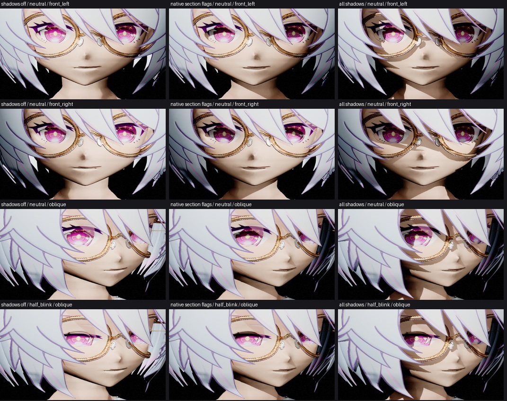

# 086 分区投影复验

用 Unreal 对照全关投影、全部部件投影和打包脚本的分区投影设置。包内标记关闭前发、后侧发、发饰和镜框四个区段的投影，脸、颈与服装各区段保留受光关系。按同一份规则生成只用于预览的会话网格。

脱外套中性近景的固定眼周与下颌取样区，在左右灯位有 60,151 与 63,044 个像素因全部投影而降低亮度超过 12。按打包标记分别降到 24,663 与 23,960 个。眼镜下方和眉骨间的整片硬影明显减弱，脸颈遮挡仍能看见。非投影、全投影和分区设置的效果都受本场景的灯位和强度影响。 [Unreal 骨骼网格分区投影接口](https://dev.epicgames.com/documentation/en-us/unreal-engine/python-api/class/SkeletalMeshEditorSubsystem?application_version=5.7)

将分区设置加入 `PBZ_BAIQI_PREVIEW_SHADOWS=package`。独立复跑两种形态与中性、半眨眼两个状态，16 张图逐像素一致。

