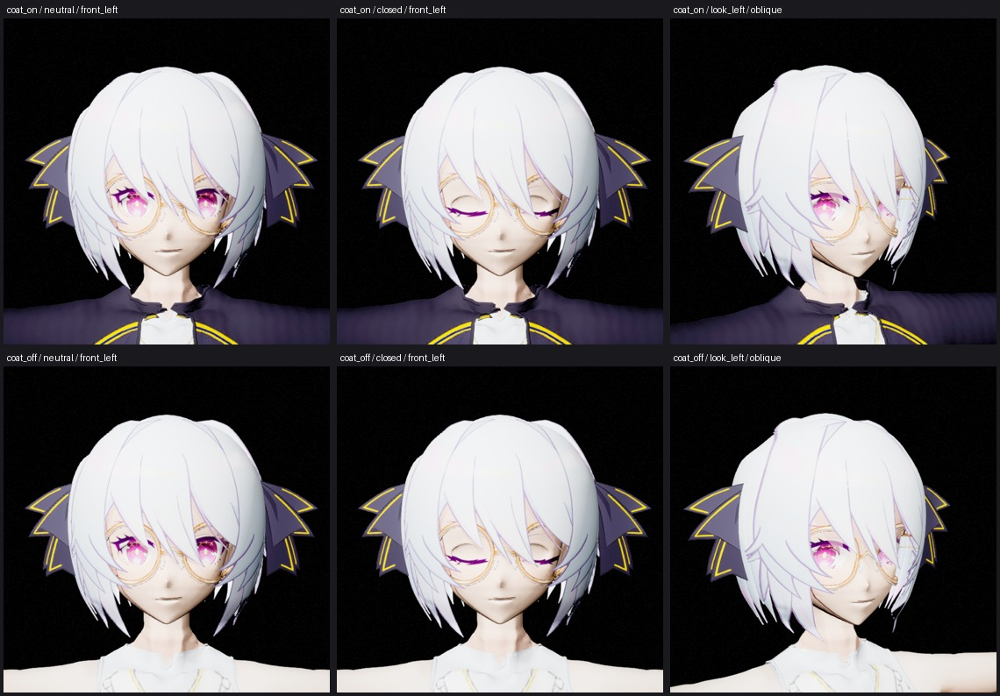

# 白绮 Unreal 离线彩色验收

这个预览用 UE 编辑器导入的两套骨骼网格和同一版本的烘焙 PNG 出图。灯位、机位与曝光参数固定，支持正面左右光、斜视和斜后视。用本地预览材质读取颜色、AO、粗糙度、金属度和切线法线。游戏正式版会继承原游戏材质，发行时还需要核对游戏内的灯光和换装效果。 [Unreal 材质输入](https://dev.epicgames.com/documentation/en-us/unreal-engine/material-inputs-in-unreal-engine)

复用已有的 `build/UE/ProjectPBZ` 编辑器工程。先按版本的验收流程生成 `surface_finish_readback.json`，准备 `native_textures`、`engine_materials.json`、`surface_finish.json` 和 `eye_palette.json`。在仓库根目录运行以下命令。每次从原 PNG 导入会话纹理，避免渲染复跑丢失色图。程序在首张正视图检查脸与发饰颜色，随后按形态、状态和机位写 PNG 和 `preview_manifest.json`。

```powershell
$env:PBZ_BAIQI_EDITOR_INPUTS = 'build/baiqi_083_game_inputs'
$env:PBZ_BAIQI_PREVIEW_OUT = 'artifacts/baiqi_083_unreal_preview'
$env:PBZ_BAIQI_PREVIEW_STATES = 'neutral,half_blink,closed,look_left,look_right'
$project = (Resolve-Path 'build/UE/ProjectPBZ/ProjectPBZ.uproject').Path
$script = (Resolve-Path 'scripts/ue_render_baiqi_offline_preview.py').Path
& 'E:/UE_5.7/Engine/Binaries/Win64/UnrealEditor-Cmd.exe' $project -unattended -nop4 -stdout -FullStdOutLogOutput -RenderOffscreen -AllowCommandletRendering -d3d12 -NoAsyncAssetCompilation -run=pythonscript "-script=$script"
```

默认 `neutral` 输出两形态各四张。上面的五状态命令输出 40 张。这个预览检查静止形态和材质切换，动作范围继续用 Git 库里的白绮动作套组复验。

103 回归使用 `PBZ_BAIQI_PREVIEW_SHOT_SET=regression` 加入另一侧斜视，五种状态共 50 张。`mouth` 使用低位灯光和八个机位，取 `neutral`、`lit`、`albedo` 两组共 32 张。新机器的工程恢复和完整命令见 [交接手册](../docs/BaiQi_Handover.md#unreal-离线读回)。

083 起，PNG 使用同步纹理导入，在线性遮罩和法线完成编译后出图。最初的 Mix 对照中，材质实例回读返回正确的纹理对象，但诊断图上的面部采样为黑色。同步后原图与整脸强对照在正视图中已有约 10.6 万像素的通道差大于 4。1280 像素图也使用了较低光强，为亮部留出余量。对比版本时请用同一份渲染脚本分别重出旧版和新版。

`PBZ_BAIQI_PREVIEW_PASS` 默认 `lit`。可设为 `albedo` 看基本色，`normal` 看世界空间法线，或 `mix` 看 AO、粗糙度、金属度图。诊断图是按 sRGB 导出的，读单个纹素的线性值时须考虑转换。材质光泽比较需要看同灯位的 `lit` 图。

`PBZ_BAIQI_PREVIEW_PROFILE` 默认 `close`，即 101 厘米机位和 1280 像素图。`portrait` 用 375 厘米机位出 640 像素图，用于观察缩小后的发梢、眼镜与服装材质边缘。对照时给不同机位指定不同的输出目录。

`PBZ_BAIQI_PREVIEW_SHADOWS` 可设为 `package`，让会话网格采用与打包脚本相同的分区投影标记，以检查头颈和上衣的自投影。默认 `off` 便于分离贴图与受光。用同一档进行版本对照。


